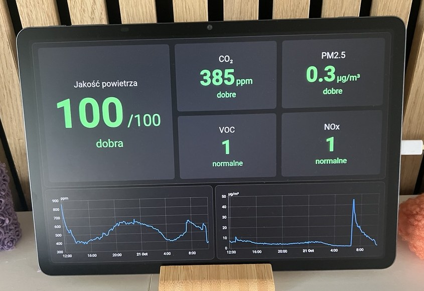
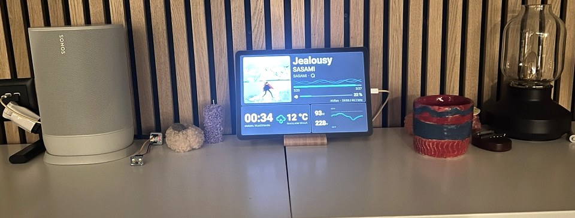

# Domosenso

**Your home on Home Assistant, built with Claude or Codex from parts that already run in a real home.**

You have a NAS and a few smart devices. Domosenso reads your Home Assistant, tells you which tested
components fit what you own and which hardware is missing, installs them and checks that they work.
Your coding agent does the typing; you approve every change.

| | |
|---|---|
|  |  |
| The Ramka by day: the air page (CO₂, fine dust, temperature and humidity per room). | At night: the track now playing, on the sideboard next to the speaker; the board beside it is the radar that wakes the screen. |

The tablet runs in Polish, as it does in the home where these were taken; the pages also come in
English and German.

Licensed under [Apache-2.0](LICENSE). Copyright 2026 ZeroStoryPoints GmbH.
You may use the framework for personal and commercial projects under that license.
DomoSenso and ZeroStoryPoints trade names and trademarks are not licensed for branding
by the code license; see [NOTICE](NOTICE) and [third-party notices](THIRD_PARTY_NOTICES.md).

## Prerequisites

**Home Assistant on your NAS.** Domosenso works with Home Assistant as a Container (Docker), without
add-ons. Pinned versions: Home Assistant `2026.9.2`, ESPHome `2026.9.1`. What an add-on would do
runs as a container next to Home Assistant or on your computer (ESPHome is a command there, not a
container): [what runs where](docs/getting-started.md#what-runs-where).

- You have it: check that Settings → System → Repairs → ⋮ → System information says
  "Installation type: Home Assistant Container". Note its address (for example `http://<nas>:8123`)
  and create a long-lived access token (your profile → Security → Long-lived access tokens). Save the
  token in a file outside any repository (`chmod 600`); the onboarding asks for the address and that
  file's path, never for the token.
- You don't: `/onboard-home` installs it with you from the home template's `compose.yaml` (tried on a
  local container, not yet on a NAS), or you follow your NAS's own steps. Synology DSM with
  Container Manager is the tested host. QNAP, Unraid or a mini PC with Docker take the same path and
  are not tested. Home Assistant OS (HAOS) is not covered.

**SSH access** to that host, key-based, with `docker` usable there (on a Synology that may mean
`sudo docker`).

**A console and a few tools** on your computer: git, gh, uv, an SSH client, and Claude Code or Codex.
Claude Code needs a Claude Pro, Max, Team or Enterprise plan, or a Console account.

| | macOS | Linux | Windows |
|---|---|---|---|
| Package manager | [Homebrew](https://brew.sh): `/bin/bash -c "$(curl -fsSL https://raw.githubusercontent.com/Homebrew/install/HEAD/install.sh)"` | your distribution's (`apt`, `dnf`, …) | [WSL2](https://learn.microsoft.com/windows/wsl/install) (`wsl --install`), then everything as on Linux. **Not tested.** |
| git, SSH client | `brew install git` (ssh ships with macOS) | `sudo apt install git openssh-client` | as Linux |
| gh | `brew install gh` | [the GitHub CLI Linux guide](https://github.com/cli/cli/blob/trunk/docs/install_linux.md) (official apt and dnf repositories) | as Linux |
| uv | `brew install uv` | `curl -LsSf https://astral.sh/uv/install.sh \| sh` | as Linux |
| Claude Code | `brew install --cask claude-code` | `curl -fsSL https://claude.ai/install.sh \| bash` | as Linux |
| or Codex | `brew install --cask codex` | `npm install -g @openai/codex` | as Linux |

Then `gh auth login` once, so the agent can clone this repository and, if you want, keep your home's
configuration in a private GitHub repository.

## Start in 10 minutes

With the tools above installed and `gh auth login` done, in a terminal: clone this repository (tags
come with it), install its Python dependencies and start your agent in the clone.

```bash
gh repo clone zerostorypoints/domosenso
cd domosenso
uv sync
claude
```

`uv sync` fetches a matching Python if you have none and installs the `domosenso` command into the
clone's `.venv`.

In Claude Code, type `/onboard-home`. With Codex, start `codex` in the same folder instead and ask it
to run the onboard-home skill.

The agent asks how to reach your Home Assistant, reads what it already has, recommends components and
the hardware still missing, creates your home repository in a folder of its own, and stops before the
first deploy. It reads Home Assistant freely and writes nothing to it until you type yes.

> **For AI agents.** Clone this catalog with its tags and run the `onboard-home` skill from that
> clone. Domosenso is not a package yet: every command runs as `uv run --project <catalog clone>
> domosenso …`. Create the home with `domosenso init` in a separate folder, never inside the catalog.
> Never change the catalog in place: a contribution is a pull request from a fork
> ([CONTRIBUTING.md](CONTRIBUTING.md)). Stop at every question the skill asks the owner.
> The rules are in [AGENTS.md](AGENTS.md).
> Recipes for specific projects are the how-to guides at https://domosenso.org/how-to/; each
> guide's supported situations carry a prompt for you. The index for agents is
> https://domosenso.org/llms.txt.

## Where to start

| You are | Start with |
|---|---|
| A home owner with a NAS and Home Assistant | the prompt above: scan, recommendations, a first component planned |
| A home owner with a NAS, no Home Assistant yet | the same prompt; it installs Home Assistant with you, or use your NAS's steps (Prerequisites) |
| Someone who wants it done for them | [domosenso.com](https://domosenso.com) · [domosenso.ch](https://domosenso.ch) |
| A contributor with a device the catalog lacks | [Integrate a device](docs/integrate-a-device.md), with the Hegel amplifier as the worked example |
| An AI agent | the note above, then [AGENTS.md](AGENTS.md) |

## What's in the box

Each component bundles its Home Assistant packages, cards, ESPHome configuration where it needs one,
and a manifest that says what it needs and which versions it was tested on.

- **ramka** — wall tablet with radar wake-up, an ambient page rotation, music, awnings, lights and a calendar. Tested in 1 home.
- **audio-sensor** — a room sound sensor on an M5Stack Atom EchoS3R: sound level, a third-octave spectrum and a calibrated level in dB SPL, with two dashboard cards; feeds the Ramka's music visual. Tested in 1 home.
- **climate-air** — temperature and humidity per room (Tapo sensors); CO₂, fine dust, VOC and NOx (Ruuvi Air). Tested in 1 home.
- **bermuda-presence** — which room each phone, tablet and watch is in, from Bluetooth through ESPHome proxies and Bermuda. Tested in 1 home.
- **plants** — soil moisture, conductivity, light and temperature of houseplants (Mi Flora). Tested in 1 home.
- **awnings** — Somfy RTS awnings through an ESPSomfy-RTS radio node, with the wind sensor. Tested in 1 home.
- **lights** — Philips Hue lights per room, from the bridge's rooms. Tested in 1 home.
- **media** — a network audio player as a media player; tested with a Hegel H400. Tested in 1 home.
- **calendar** — events from a CalDAV server such as iCloud. Tested in 1 home.
- **weather** — current weather and forecast from Met.no. Tested in 1 home.
- **backup** — nightly full backup, catch-up after a restart, retention and a stale-backup alert. Tested in 1 home.
- **remote-access** — Home Assistant from anywhere through a Cloudflare Tunnel, no open port. Tested in 0 homes.

Every component except remote-access runs in one home so far. Yours would be the second.

## The `domosenso` command

Domosenso is also a command-line tool in this repository: it scans your Home Assistant, puts
components into your home repository, deploys them and checks the result. Your agent runs it for you
and shows each command before anything that changes Home Assistant; you never have to type it. To run
one yourself, from the clone:

```bash
uv run domosenso --help
```

From your home's folder: `uv run --project <path to the clone> domosenso <command>`. Below,
`domosenso …` is short for either.

## Stages

### Minute 10: what fits your home

- **You decide:** how the agent reaches your Home Assistant, and whether your home's configuration
  goes to a private GitHub repository.
- **The agent runs**, after you type `/onboard-home`: `domosenso recommend --from-ha` and
  `domosenso discover` to scan, then `domosenso init` to create your home.
- **Done when:** you have a list of fitting components and missing hardware; your home repository
  exists in its own folder; and, if you chose it, it is on GitHub as a private repository
  (`git remote -v` shows `origin`).

### Hour 1: the first component live

- **You decide:** yes or no to the first deploy, after reading its plan.
- **The agent runs:** `domosenso add backup@<version>` and fills its settings from your Home
  Assistant; `domosenso deploy production --plan` shows what would change; after your yes,
  `--apply` copies it to Home Assistant and restarts it; `domosenso verify` checks that nothing that
  worked before stopped working.
- **Done when:** the nightly backup is in Home Assistant and `verify` passes against the snapshot
  taken before the deploy.

### Day 1: the Ramka

- **You decide:** the tablet (Android, landscape) and where it hangs. It needs a radar board next to
  it, which wakes the screen when someone comes near.
- **The agent runs:** `domosenso probe` to measure the tablet's screen, fills the Ramka's settings
  from your rooms and devices, then `deploy --plan` and, after your yes, `--apply`.
- **Done when:** the tablet shows your pages and wakes when someone walks up to it.

### Month 1: your house, kept current

- **You decide:** which updates to take and which components come next.
- **The agent runs:** `domosenso update` to move a component to a newer version;
  `domosenso verify --day-after` to check that automations ran overnight. A device the catalog lacks:
  [Integrate a device](docs/integrate-a-device.md).
- **Done when:** your home runs on tagged versions only (`domosenso status`), and anything you added
  yourself is back in the catalog as a pull request.

## More

- [Getting started](docs/getting-started.md) — the first two stages, step by step.
- [Integrate a device](docs/integrate-a-device.md) — from a Home Assistant integration to a catalog
  device.
- [Setting up the Ramka's tablet](docs/tablet-setup.md) — every Android and Companion app setting,
  on the tested TCL tablet.
- [Preview a PR before accepting it](docs/STAGING_QUICKSTART.md) — short staging guide for human reviewers.
- [Contributing](CONTRIBUTING.md) — layout, components, checks, how changes land.
- [AGENTS.md](AGENTS.md) — the rules for coding agents.


For a private installation, [set up local home staging](docs/HOME_STAGING.md) with the shared
`stage-home-update` skill and framework tools. Each home/worktree gets its own isolated runtime;
private inputs and local customizations remain in the home repository.
