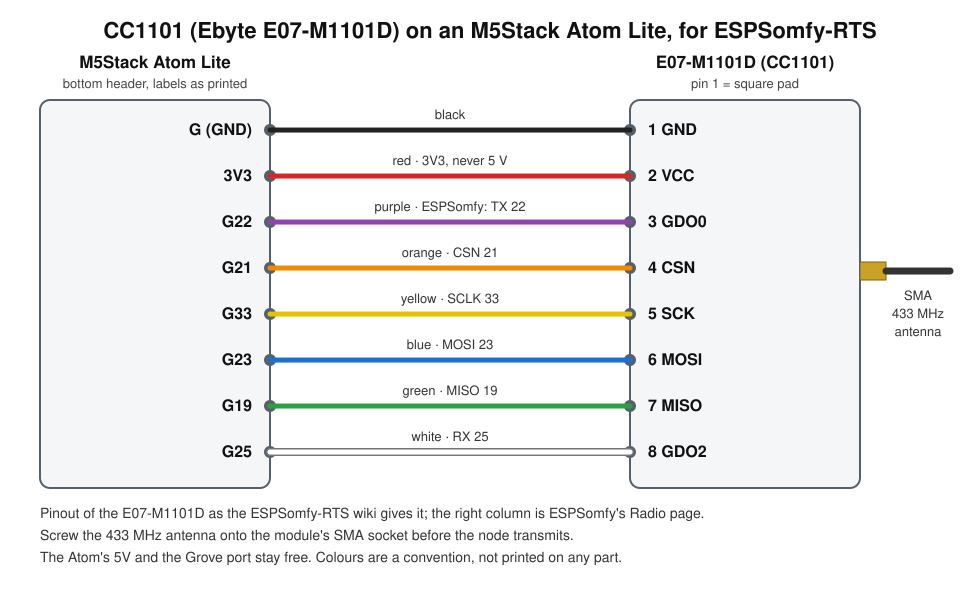

# CC1101 radio module: wiring and setup

A CC1101 433 MHz transceiver, the Ebyte **E07-M1101D** with an SMA antenna socket, on an M5Stack
Atom Lite that runs ESPSomfy-RTS: the `awnings` component's node, which sends and hears Somfy RTS.
Device file: [cc1101.yaml](cc1101.yaml).

## Wiring

| E07-M1101D pin | signal | Atom Lite (bottom header) | wire | ESPSomfy-RTS, Radio page |
|---|---|---|---|---|
| 1 | GND | G | black | |
| 2 | VCC | 3V3 (**never 5V**) | red | |
| 3 | GDO0 | G22 | purple | TX 22 |
| 4 | CSN | G21 | orange | CSN 21 |
| 5 | SCK | G33 | yellow | SCLK 33 |
| 6 | MOSI | G23 | blue | MOSI 23 |
| 7 | MISO | G19 | green | MISO 19 |
| 8 | GDO2 | G25 | white | RX 25 |

Pin 1 has the square pad. The pinout is the one the ESPSomfy-RTS wiki gives for this module; it is
the wiring of the first home's node. The Atom's 5V and the Grove port stay free. Another CC1101
board (a different maker) can number its pins differently: go by the signal names printed on it,
not by the numbers.

## The antenna

- Screw a **433 MHz** antenna onto the SMA socket before the node transmits. A CC1101 sending into
  an open socket can damage its output stage (general radio practice, not seen here).
- The antenna decides what the node hears. One home's wind sensor reached the node at −83 to
  −86 dBm and only part of its reports arrived, with gaps of hours (`components/awnings/README.md`).
  Stand the antenna upright and move the node, or the antenna on a short cable, towards the
  sensor and the awnings; keep it clear of metal.

## Firmware and first start

ESPSomfy-RTS is a release binary flashed over USB with `esptool`, then set up in its own web
page: the network, then on the Radio page the pins of the right-hand column above, then MQTT and a
virtual remote per awning. The commands and steps: `components/awnings/README.md`, "Flashing the
node". The radio answers when `GET http://<node>/controller` shows
`transceiver.config.radioInit: true`; `false` means the CC1101 did not answer on SPI with these pins
(a wire on the wrong socket, or VCC missing).

## When it does not work

| what you see | likely cause |
|---|---|
| `radioInit: false` | a wire on the wrong socket, the pins in ESPSomfy's Radio page not matching the wiring, or VCC not on 3V3 |
| awnings do not move, the node logs sending | no antenna, or the virtual remote not paired with the awning |
| the node hears the handsets only sometimes | reception: antenna position and distance |

The second and third rows are inference from how RTS works, apart from reception, which the first
home saw.
