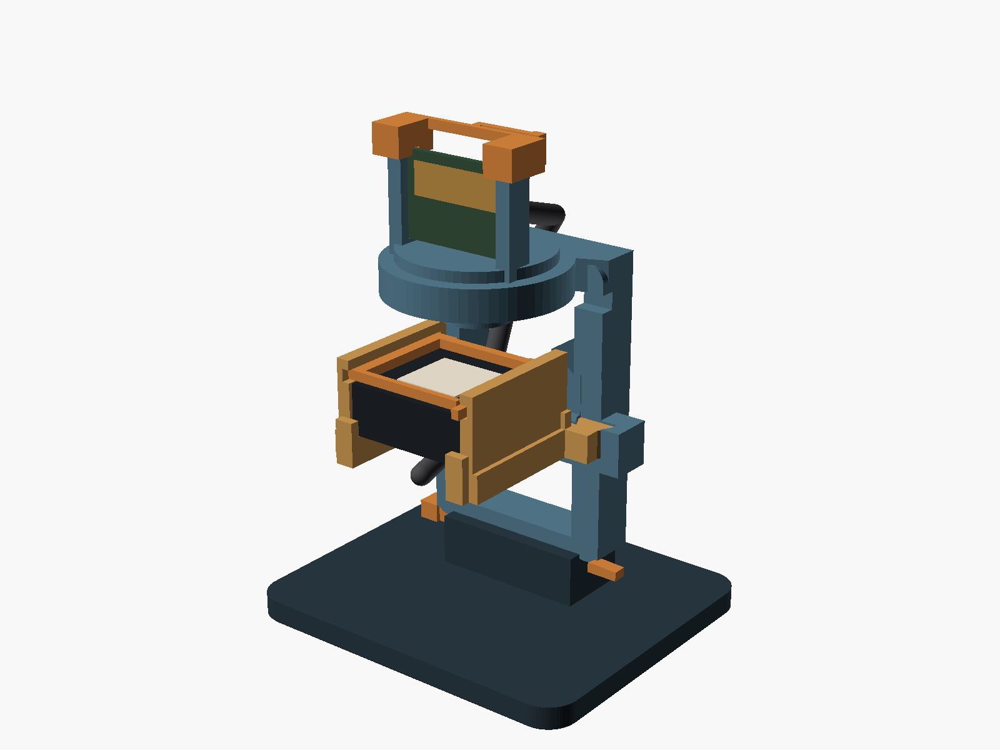
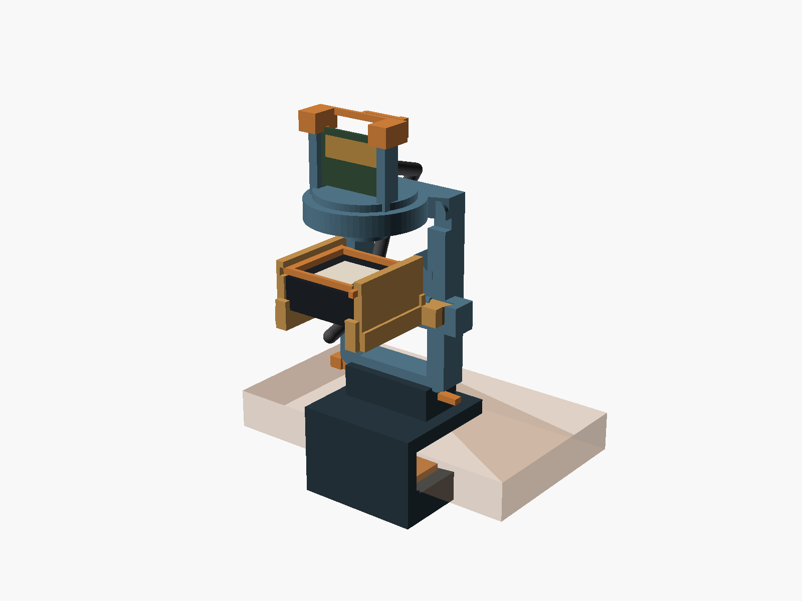

# Atom Lite and LD2410C modular mount

A printable open mount for an M5Stack Atom Lite and an HLK-LD2410C radar, with interchangeable
standing and shelf-edge bases. The Atom's button faces up; its GPIO harness passes below its
case. The radar remains vertical while its head turns left and right. All mechanical fasteners
are printed. Wiring and firmware remain as described in the [device guide](../../hlk-ld2410c.md).

**Prototype: sample fit reported, complete mount untested.** Print the interface sample before
the complete mount. A successful mesh check does not establish clamping force, stability,
friction or radar performance.

First-print feedback: the test sample had obstructing plastic at the spindle bore entrance,
key channels and other interfaces. The other sample parts fit, and the long key passed through
the sample base receiver after clearing it. Inspection of the original toolpaths confirmed
support inside these interfaces. The printable dimensions remain unchanged. Non-printing
support blockers and snug supports remove these paths in the revised slicing check; that
revision has not been physically printed. Full-mount stability, shelf grip and individual
latch/locking forces remain unverified.

| Standing base | Shelf clamp |
|---|---|
|  |  |

The radar centre is 72 mm above the support; the highest printed part is 84.63 mm above it.
The clamp also extends 22.9 mm below the shelf top. Its 18 mm under-edge engagement is measured
horizontally, independently of that vertical drop.

## Parts and assembly

Print one each of `tower`, `head`, `radar_keeper`, `atom_cradle`, `atom_keeper`, `base_key` and
`head_key`. Add `stand` for the desktop version, or `clamp` and `clamp_wedge` for the shelf version.
Print both bases to interchange them. The [STL folder](stl/) contains all parts;
[enclosure.scad](enclosure.scad) is the editable source.


1. Lower the mast into the base's keyed socket. Feed the narrow end of `base_key` from left to
   right through the aligned slot, then seat gently until play is removed.
2. For the shelf base, slide the clamp over the edge and insert `clamp_wedge` from the left,
   flat face upwards. Advance it until both jaws bear; pull its tab to release.
3. Lower the head into the bearing at zero yaw, with its stop lug in the arc. Insert `head_key`
   from the left beneath the bearing. Ease it out before turning the head and reseat by hand.
4. Slide the radar into its edge rails from above, antenna outward, then lower `radar_keeper`
   onto both rails until its rear latch engages. Pull the rear tab away from the PCB to release
   the cap. Check that the antenna face remains unobstructed.
5. Connect the Atom's lower jumpers while its cradle is accessible. Fit the Atom button up,
   USB-C towards the front, and slide `atom_keeper` front to back until its right latch engages.
   Lower the cradle's rear teeth
   into the tower. Route the wires through the open mast with a free loop at the head.
6. Check both yaw endpoints and the centre. No connector may be pulled or used to restrain
   rotation. For service, press the keeper's front-right tab towards the centre and slide it
   forward; lift the cradle out as needed.

The tapered keys are shown released in collision checks. Further insertion deliberately brings
their faces into contact; the physical force and friction have not been measured. Do not hammer
them in.

## Build and customize

Install Python 3.11 or newer and OpenSCAD with its Manifold backend. The export wrapper needs
only the Python standard library. From this directory:

```sh
python3 build.py
python3 build.py --part fit_coupon --out /tmp/radar-fit
python3 build.py -D shelf_thickness=16 --out /tmp/radar-shelf-16
python3 build.py --support-blockers --no-preview --out /tmp/radar-with-blockers
```

`OPENSCAD` may name the executable when it is not on `PATH`. Exported meshes are already in
their intended print orientation, with their lowest face at Z=0. Custom outputs belong outside
the reference `stl/` directory so it remains clear which files match the default source.

For the optional external design and verification tools, follow
[3D printing setup](../../../docs/3D_PRINTING.md). With `SKILL_DIR` set to the installed skill:

```sh
python3 "$SKILL_DIR/verify-model.py" enclosure.scad \
  --build-volume 256x256x256 --export /tmp/radar-verified
```

Use your own printer's build volume. Repeat the gate with the same `-D` values used for export.
Rebuild both sides of a mating interface when changing its dimensions.

| Parameter | Purpose |
|---|---|
| `radar_center_height` | Height above the supporting surface; reference 72 mm |
| `yaw_limit` | Left/right travel, reference 60 degrees each way |
| `atom_clearance` | Case underside to base top, reference 27 mm |
| `shelf_thickness`, `shelf_engagement` | Shelf thickness and under-edge reach |
| `jumper_total_length` | End-to-end length, including housings |
| `atom_connector_housing`, `radar_connector_housing` | Rigid connector lengths deducted from available wire |
| `radar_thickness`, `radar_rear_depth` | PCB and rear hardware fit assumptions |
| `fit_clearance`, `hole_compensation` | Sliding clearance and separate hole-size compensation |

## Printing

The starting settings are PETG, 0.20 mm layers, four walls and 25% gyroid infill. PLA can be
used for a rigid prototype, but fit and wedge retention must be checked in the material actually
used. Print each part in its exported orientation. Inspect bridges and flange undersides in
the slicer; the geometry gate's overhang report does not establish that a part needs no supports.

Provide removable external supports under the head flange/stop lug and unsupported bearing
faces. Exclude supports from the spindle bore and its entrance, both key channels, base sockets,
Atom keeper channels, mast docking slots and wire eye. The reference export includes optional
non-printing volumes in `blockers/`, generated by [support-blockers.scad](support-blockers.scad).
Keep each blocker in the same coordinates and orientation as its matching STL: import them as
parts of one object, change the blocker volume's type to **Support blocker**, and move them
together. Never print a blocker as a normal part or position it independently at the bed centre.
Use the same `-D` overrides for printable parts and blockers.

In Bambu Studio, the checked combination is **Normal (auto)**, style **Snug**, with
`raft_first_layer_expansion=0`. Default grid-style supports can fill the bore entrance even
with a blocker; automatic first-layer support expansion can also cover its bottom opening.
The blockers alone are therefore insufficient. A native CLI assembly can attach each volume
with `subtype: "support_blocker"` and the same nonzero `assemble_index` as the printed mesh.
Keep machine/material profiles local and inspect the sliced paths, not just the modifier shape.

The revised local toolpath check found no support extrusion in the sampled interiors of the
spindle bores/entrance, key channels, base sockets or Atom keeper channels. Bridges across the
horizontal tower bore and clamp socket still need physical inspection: a support-free channel
can have a sagging roof. The cradle has two small first-layer hook islands; retain an outer brim
where needed. Remove external supports before checking fit, without scraping fitted surfaces.
The keeper latches are designed for PETG: their nominal beam-strain estimates are 1.58% and
1.41%. These estimates do not certify fatigue life or make PLA a tested latch material.

Optional Bambu Studio projects can be made from the STL with the installed skill. Supply your
own machine, material preset and support choice:

```sh
python3 "$SKILL_DIR/make-bambu-3mf.py" --mesh stl/fit_coupon.stl \
  --printer "$PRINTER" --filament "$FILAMENT_PRESET" \
  --layer-height 0.2 --walls 4 --infill 25 --infill-pattern gyroid \
  --supports "$SUPPORTS" --scatter off --out /tmp/radar-fit.3mf
python3 "$SKILL_DIR/bambu-cli.py" slice /tmp/radar-fit.3mf
```

`SUPPORTS` is `on` or `off`, selected after inspecting that part. These commands generate and
slice files locally; they do not send a print job. Printer presets and installation-specific
projects are not part of the shared source.

## Measurements and fit

The nominal Atom case is 24 × 24 × 9.5 mm; the radar board outline is 22 × 16 mm.
The reference design provides 27 mm under the Atom for a 25 mm connector-and-wire envelope.
Keep the GPIO region open, and check that the USB plug enters without pushing the Atom out of
its cradle. The keeper must hold the case edges without bearing on the button.

Jumper length includes the connector housings: a 120 mm female-to-female jumper is **not**
120 mm of flexible wire. Housing lengths and the radar's PCB thickness and rear component
projection need measurement or a trial fit. Check the wire route at both yaw limits with
gentle bends and slack. Lower the radar when the available wire cannot follow that route.
Do not use the connector pins as a strain relief.

The shelf thickness is adjustable. Confirm the depth and thickness of its unobstructed edge
before making the clamp; tighten its printed wedge gradually. A reference dimension does not
establish that a clamp fits every shelf or that its surface will tolerate contact pressure.

## First print

Use the intended material and layer settings for the fit sample. Check insertion and removal
of the printed keys, the pivot clearance, the Atom case rim and the radar carrier. Adjust the
source's fit allowances if a joint binds or falls free. Do not force the PCB or its components
into an undersized carrier.

The nominal wire route is 76.80 mm at centre and up to 83.12 mm at the yaw endpoints. With two
assumed 14 mm housings and a provisional 3 mm allowance for endpoint spread, the calculated
remaining margin is 5.88 mm. The collision check uses a 4 mm representative bundle. These are
model estimates: actual individual pin paths, connector angles and bend radii remain unverified.


After assembling the complete prototype, check that the button can be pressed without tipping
the standing base, the clamp does not slip, and the head stays aimed while the wires remain
slack. Test presence sensing after placing the radar; mechanical clearance alone does not
validate its RF performance.

## Verification record

OpenSCAD 2026.10.11 passed 41 geometry checks: 11 manifold connected printable solids on Z=0,
assembly views, sampled insertion/yaw collision checks and two latch diagnostic renders. The
locked latch probes separately produced solid interference; the released paths were empty.
The head and cable checks sample 25 yaw poses from −60 to +60 degrees.

Independent artifact review found loose keepers and insufficient key travel in the first draft.
The revised source adds releasable printed latches and includes the complete key clearance stack.
Corrective review confirmed all four findings addressed at CAD level, including an independently
rendered near-contact head-key check. Sonnet/Fable were unavailable on this host; review used
the available GPT-6 Astra model. This is geometry review, not physical acceptance.

The source and build wrapper are reusable without the external skill. Re-export and run the
gate after parameter changes; the above record applies to the reference dimensions.

## Sources

- [M5Stack Atom Lite](https://docs.m5stack.com/en/core/Atom-Lite), nominal case dimensions;
  the repository's [dimension record](../../m5stack-atom-lite.yaml) records its interfaces.
- [Hi-Link LD2410C](https://www.hlktech.com/NewsInfo-276.html), nominal board outline.
- [Design specification](../../../docs/superpowers/specs/2026-11-15-atom-radar-mount-design.md).

Original design and source: Apache-2.0, like the repository. Electronics shown in assembly
previews are clearance references and are not printable parts.
