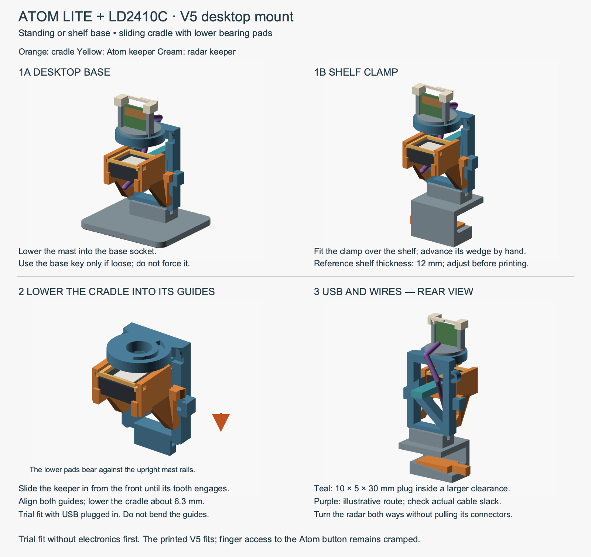
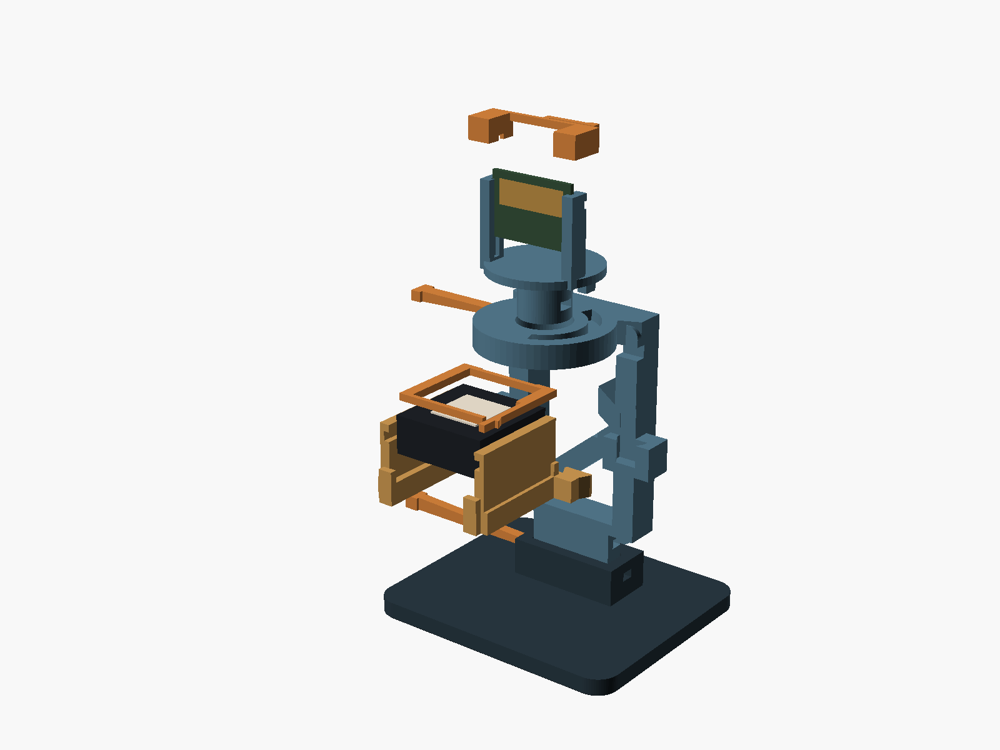

# Atom Lite and LD2410C modular mount

A printable open mount for an M5Stack Atom Lite and an HLK-LD2410C radar, with interchangeable
standing and shelf-edge bases. The Atom's button faces up; its GPIO harness passes below its
case. The radar remains vertical while its head turns left and right. All mechanical fasteners
are printed. Wiring and firmware remain as described in the [device guide](../../hlk-ld2410c.md).

**V5 trial: the user reports that all parts now fit.** Finger access to the Atom button
is still cramped below the yaw bearing. This is one successful physical fitting, not
a measurement of retention force, fatigue life, stability or radar performance.

The current downloadable design is **V5**, frozen after that fitting report. The proposed
button-access bevel below is not included in the source or printable files.



For a new build, follow [Parts and assembly](#parts-and-assembly) and [Printing](#printing).
The [STL files](stl/) work with other slicers; [build.py](build.py) regenerates meshes and
support-exclusion volumes from [enclosure.scad](enclosure.scad). Render this guide with
`uv run devices/enclosures/hlk-ld2410c-atom-lite/assembly-guide.py` from the repository root;
install OpenSCAD and Cairo first. On macOS with Homebrew Cairo, prefix the command with
`DYLD_FALLBACK_LIBRARY_PATH="$(brew --prefix cairo)/lib"`. These are CAD illustrations,
not installation photographs.

## Prototype history

First-print feedback: the test sample had obstructing plastic at the spindle bore entrance,
key channels and other interfaces. The other sample parts fit. The long key entered the sample
base receiver from one side, but its openings also contained obstructing plastic. Inspection of the original toolpaths confirmed
support inside these interfaces. The printable dimensions remain unchanged. Non-printing
support blockers and snug supports remove these paths in the revised slicing check; that
revision was subsequently printed, with the additional findings below.

### Complete-mount feedback (2026-11-16)

- The shelf clamp worked in the reported trial. The mast was a tight fit in that clamp's socket
  without a base key. This is one physical fit result, not a verified retention force or proof
  that all materials and printers can omit the key. Keep it optional when the actual fit is
  already secure; do not force it into a tight joint.
- The cradle could not seat on the mast with the USB plug and cable in the tested orientation.
  The previous model's `usb_env()` checked only a forward-facing plug; the trial routed USB
  towards the mast. That revision had not validated the diagonal braces and docking region
  for a rear-facing plug.
- One cradle docking hook broke while trapped support was removed from the gap behind it.
  The previous hook had a 0.7 mm rear joining web and a narrow, inaccessible support gap.
  Neither strength during cleanup nor support removability was established by the mesh gate.
- The lower wire bend was cramped. The requested correction is 10 mm more mast height and
  cable-routing room. Raising the radar alone would consume jumper slack: the revised design
  must evaluate the cradle height, both connector ends and the complete cable path together.
- Correction: the revised solid guides and rear USB clearance replace those hooks and
  obstructions. At that stage, a new fit test with USB and all radar wires connected was still required. Standing-base
  stability, long-term clamp retention and unobstructed yaw with the real harness remain
  unverified. Private photos and printer-specific records are kept outside this repository.

### Revised-guide physical feedback (2026-11-16)

At the V4 trial, all three replacement parts were reported printed and installed. The cradle had
excessive play in its tower receivers and pitches forward/down, rather than staying square.
The Atom keeper fell out without useful resistance; the release direction and condition
of its latch/rail lips have not yet been established. The radar keeper did not fully seat;
obstructing plastic had to be removed. The saved full-mount toolpath contains 22 support
segments inside its right rail pocket (sampled at 0.15 mm). The previous audit did not
cover these pockets. No support centreline was found in the PCB slots or upper rail
mating surfaces in that file. This identifies a support-placement defect, but does not
prove the actual print used identical paths or rule out dimensional/component interference.

The real harness is only just long enough. Preserve both module heights during the next
correction. The calculated wire reserve is not a measurement of installed slack.

The V5 correction adds 0.15 mm to the male guide profiles only, reducing nominal clearance
against the existing V4 receivers from 0.30 to 0.15 mm per side. Two lower pads bear against
the mast below those receivers; they are part of the cradle and leave the central GPIO bay
open. The pads have a nominal 0.15 mm gap, with their bottom 18 mm below the guide bottoms.
These are coupon targets, not validated printing tolerances or a measured stiffness.

The Atom keeper is 2.25 mm thick instead of 1.8 mm, with 1.60 mm captured guide edges
instead of 1.15 mm. Its separate sliding allowance is 0.15 mm. A 1.0 mm latch tooth and an
open side window make engagement inspectable. The radar cap has 0.30 mm rail-pocket
clearance, 0.40 mm entry bevels, and explicit support exclusions at both pockets and the latch.
The nominal gap above the PCB to the cap crossbar remains approximately 2.8 mm: **do not
push the crossbar onto the PCB**. The rail engagement is 3.8 mm when fully seated.

The three small replacement parts serve as the next fit sample on the existing mount;
there is no need to print another tower or base for this trial. The later fitting report
below supersedes the initial fit uncertainty; quantified strength remains unverified.


### V5 fitting result and button access

The subsequent physical trial reported that all parts fit; the remaining reported issue
is limited room for a finger to press the Atom button. The stationary yaw-bearing ring
above it was identified as the candidate for a gentle underside/front bevel. Keep the
working V5 interfaces and both module heights as the baseline. A possible 3 mm-high,
5 mm-radial-width bevel over the front 120 degrees is an analytical proposal only; no
production source, STL or Bambu project has been changed for it. At the outer radius of
the stop channel it would leave at least 2.4 mm of floor vertically, and preserve the top
3 mm of the full-radius ring. This improves entry at the edge, not the entire space above
the button; the shaft and key remain in the centre. Ergonomics and the modified part would
need CAD, slicer and physical verification before release.

| Standing base | Shelf clamp |
|---|---|
|  |  |

The radar centre is 82 mm above the support; the highest printed part is 94.63 mm above it.
The clamp also extends 22.9 mm below the shelf top. Its 18 mm under-edge engagement is measured
horizontally, independently of that vertical drop.

## Parts and assembly

For V5, replace **atom_cradle, atom_keeper and radar_keeper**. The V4 tower, head,
both bases and their keys retain their geometry (compared against the V4 meshes).
Do not pair the thicker V5 Atom keeper with the old cradle. Use the new cradle itself as
the fit sample on the existing tower before installing electronics. `dock_coupon` remains
available for new builds; its upper receiver dimensions match V4 and V5, but it does not
represent the mast's lower bearing surface.
For a complete new set, print one each of `tower`, `head`, `radar_keeper`, `atom_cradle`, `atom_keeper`, `base_key` and
`head_key`. Add `stand` for the desktop version, or `clamp` and `clamp_wedge` for the shelf version.
Print both bases to interchange them. The [STL folder](stl/) contains all parts;
[enclosure.scad](enclosure.scad) is the editable source.



1. Lower the mast into the base's keyed socket. Feed the narrow end of `base_key` from left to
   right through the aligned slot only if needed to remove play. Omit it when the physical
   socket fit is already secure; do not force the key.
2. For the shelf base, slide the clamp over the edge and insert `clamp_wedge` from the left,
   flat face upwards. Advance it until both jaws bear; pull its tab to release.
3. Lower the head into the bearing at zero yaw, with its stop lug in the arc. Insert `head_key`
   from the left beneath the bearing. Ease it out before turning the head and reseat by hand.
4. Slide the radar into its edge rails from above, antenna outward, then lower `radar_keeper`
   onto both rails until its rear latch engages. Pull the rear tab away from the PCB to release
   the cap. Check that the antenna face remains unobstructed.
5. Connect the Atom's lower jumpers while its cradle is accessible. Fit the Atom button up,
   USB-C towards the rear/mast, and slide the revised `atom_keeper` front to back until its
   right latch engages. The keeper's rear opening leaves the USB envelope clear. Bring both
   solid dovetails above the receiver mouths (6.3 mm lift), then lower the cradle onto their
   stops. Keep the cradle level during insertion and confirm both lower pads approach the mast. It is a gravity-seated lift-off joint, not a
   latch against upward cable pulls. Route the wires under the cradle, through the corridor beside USB, then behind and
   above the bearing with a free loop at the head. Do not use the small side eye as a mandatory
   waypoint or pull the wires tight.
6. Check both yaw endpoints and the centre. No connector may be pulled or used to restrain
   rotation. For service, press the keeper's front-right tab towards the centre and slide it
   forward; lift the cradle out as needed.

The tapered keys are shown released in collision checks. Further insertion deliberately brings
their faces into contact; the physical force and friction have not been measured. Do not hammer
them in.

## Build and customize

Install Python 3.11 or newer and OpenSCAD with its Manifold backend. The export wrapper needs
only the Python standard library. From this directory:

```sh
python3 build.py
python3 build.py --part fit_coupon --out /tmp/radar-fit
python3 build.py -D shelf_thickness=16 --out /tmp/radar-shelf-16
python3 build.py --support-blockers --no-preview --out /tmp/radar-with-blockers
```

`OPENSCAD` may name the executable when it is not on `PATH`. Exported meshes are already in
their intended print orientation, with their lowest face at Z=0. Custom outputs belong outside
the reference `stl/` directory so it remains clear which files match the default source.

For the optional external design and verification tools, follow
[3D printing setup](../../../docs/3D_PRINTING.md). With `SKILL_DIR` set to the installed skill:

```sh
python3 "$SKILL_DIR/verify-model.py" enclosure.scad \
  --build-volume 256x256x256 --export /tmp/radar-verified
```

Use your own printer's build volume. Repeat the gate with the same `-D` values used for export.
Rebuild both sides of a mating interface when changing its dimensions.

| Parameter | Purpose |
|---|---|
| `radar_center_height` | Height above the supporting surface; reference 82 mm |
| `atom_usb_plug_width`, `atom_usb_plug_length`, `atom_usb_vertical_margin` | Rear USB clearance, reference 16 mm wide × 40 mm long and full case-side height + 2 mm above/below |
| `yaw_limit` | Left/right travel, reference 60 degrees each way |
| `atom_clearance` | Case underside to base top, reference 37 mm |
| `shelf_thickness`, `shelf_engagement` | Shelf thickness and under-edge reach |
| `jumper_total_length` | End-to-end length, including housings |
| `atom_connector_housing`, `radar_connector_housing` | Rigid connector lengths deducted from available wire |
| `radar_thickness`, `radar_rear_depth` | PCB and rear hardware fit assumptions |
| `fit_clearance`, `hole_compensation` | Sliding clearance and separate hole-size compensation |
| `dock_key_growth`, `cradle_pad_gap` | V5 key growth and lower mast-stop gap; preserve V4 receiver geometry |
| `keeper_slide_clearance` | Atom keeper allowance, independent of other joints |
| `radar_cap_clearance`, `radar_cap_lead_in` | Cap pocket allowance and entry bevel |

## Printing

The starting settings are PETG, 0.20 mm layers, four walls and 25% gyroid infill. PLA can be
used for a rigid prototype, but fit and wedge retention must be checked in the material actually
used. Print each part in its exported orientation. Inspect bridges and flange undersides in
the slicer; the geometry gate's overhang report does not establish that a part needs no supports.

Provide removable external supports under the head flange/stop lug, unsupported bearing
faces and outer receiver wings. Exclude supports from the spindle bore and its entrance, both key channels, base sockets,
Atom keeper channels and latch window, radar-cap pockets and release gap, mast docking slots and wire eye. The reference export includes optional
non-printing volumes in `blockers/`, generated by [support-blockers.scad](support-blockers.scad).
Keep each blocker in the same coordinates and orientation as its matching STL: import them as
parts of one object, change the blocker volume's type to **Support blocker**, and move them
together. Never print a blocker as a normal part or position it independently at the bed centre.
Use the same `-D` overrides for printable parts and blockers.

In Bambu Studio, the checked combination is **Normal (auto)**, style **Snug**, with
`raft_first_layer_expansion=0`. Default grid-style supports can fill the bore entrance even
with a blocker; automatic first-layer support expansion can also cover its bottom opening.
The blockers alone are therefore insufficient. A native CLI assembly can attach each volume
with `subtype: "support_blocker"` and the same nonzero `assemble_index` as the printed mesh.
Keep machine/material profiles local and inspect the sliced paths, not just the modifier shape.
When exporting through Bambu Studio CLI, preserve the process override list in
`different_settings_to_system`: a project may slice correctly from the CLI yet revert to system
preset values when reopened in the GUI if this list is empty. Verify support enablement, wall
count, infill and blocker types after reopening, then reslice in the GUI before calling the
project ready. A missing Support column or a substantially different model weight warrants
checking these settings; a successful CLI slice alone is insufficient.

The earlier local toolpath check sampled the spindle bores/entrance, key channels, base
sockets and Atom keeper channels. It missed the radar-cap pockets: the later audit found
support there. The V5 replacement-plate check now covers the cap pockets/release region,
Atom keeper channels/window and USB envelope; no support centreline crosses those sampled
interiors. Sampling does not establish the full deposited bead envelope or prove that a
user's resliced file has the same paths. Inspect it in line-type view before printing.

The cradle now prints **nose down**, on two deliberate front-corner feet, with an outer
brim. Its lower stops are integral; remove accessible external support from the rear roots
without scraping the fitted keys. Never auto-orient it without rechecking the blockers.
The two keepers print flat in their supplied orientations; the radar cap's pockets open up.
The cap has short unsupported latch/ledge spans which still need physical inspection for sag.
Keep the dovetail receivers, USB opening and cable corridor free of supports.
The keeper latches are designed for PETG: their nominal beam-strain estimates are approximately
1.94% (Atom) and 1.41% (radar). These estimates do not certify fatigue life or make PLA a
tested latch material.

Optional Bambu Studio projects can be made from the STL with the installed skill. Supply your
own machine, material preset and support choice:

```sh
python3 "$SKILL_DIR/make-bambu-3mf.py" --mesh stl/fit_coupon.stl \
  --printer "$PRINTER" --filament "$FILAMENT_PRESET" \
  --layer-height 0.2 --walls 4 --infill 25 --infill-pattern gyroid \
  --supports "$SUPPORTS" --scatter off --out /tmp/radar-fit.3mf
python3 "$SKILL_DIR/bambu-cli.py" slice /tmp/radar-fit.3mf
```

`SUPPORTS` is `on` or `off`, selected after inspecting that part. These commands generate and
slice files locally; they do not send a print job. Printer presets and installation-specific
projects are not part of the shared source.

## Measurements and fit

The nominal Atom case is 24 × 24 × 9.5 mm; the radar board outline is 22 × 16 mm.
The reference design provides 37 mm under the Atom for a 25 mm connector-and-wire envelope.
Keep the GPIO region open, and check that the USB plug enters without pushing the Atom out of
its cradle. The keeper must hold the case edges without bearing on the button.

Jumper length includes the connector housings: a 120 mm female-to-female jumper is **not**
120 mm of flexible wire. Housing lengths and the radar's PCB thickness and rear component
projection need measurement or a trial fit. Check the wire route at both yaw limits with
gentle bends and slack. Lower the radar when the available wire cannot follow that route.
Do not use the connector pins as a strain relief.

The shelf thickness is adjustable. Confirm the depth and thickness of its unobstructed edge
before making the clamp; tighten its printed wedge gradually. A reference dimension does not
establish that a clamp fits every shelf or that its surface will tolerate contact pressure.

## First print

Use the intended material and layer settings for the fit sample. Check insertion and removal
of the printed keys, the pivot clearance, the Atom case rim and the radar carrier. Adjust the
source's fit allowances if a joint binds or falls free. Do not force the PCB or its components
into an undersized carrier.

The revised nominal wire route is 80.05 mm at centre and up to 84.74 mm at the yaw endpoints.
With 120 mm overall length, two reference 12 mm housings and a provisional 3 mm endpoint
allowance, the calculated remaining margin is 8.26 mm. The collision check uses a 4 mm bundle
and the complete 16 mm-wide rear USB envelope. These are model estimates: actual individual
pin paths, connector angles and bend radii remain physical checks. The guide mouths are 50.2 mm
wide overall to leave structural material around both the USB and wire corridors; the lower
base tenon is unchanged. A larger overmold or longer connector housings requires reevaluating
the route, and may require longer jumpers. Do not lower the reserve just to pass the assert.


After assembling the complete prototype, check that the button can be pressed without tipping
the standing base, the clamp does not slip, and the head stays aimed while the wires remain
slack. Test presence sensing after placing the radar; mechanical clearance alone does not
validate its RF performance.

## Verification record

The original revision passed 41 geometry checks but missed the rear USB route and support-removal
load on its hooks. The corrected revision passed all 45 geometry checks, including 12 connected manifold printed
solids on Z=0, loaded cradle insertion, the USB docking path and wire/USB intersections.
Native slicing of the receiver sample and replacement-parts plate found zero support extrusion
segments in the sampled dovetail slots, USB path, keeper channels, spindle bore and lower wire
corridor. Physical guide fit, bridge finish and cable slack are still unverified. Test guide play and
upward pull-out, tower wobble, and the actual bundle in the nominal 4 mm cable corridor on
the coupon. Do not force a thicker bundle through it.

Original evidence: OpenSCAD 2026.10.11 passed 41 geometry checks: 11 manifold connected printable solids on Z=0,
assembly views, sampled insertion/yaw collision checks and two latch diagnostic renders. The
locked latch probes separately produced solid interference; the released paths were empty.
The head and cable checks sample 25 yaw poses from −60 to +60 degrees.

Independent artifact review found loose keepers and insufficient key travel in the first draft.
The revised source adds releasable printed latches and includes the complete key clearance stack.
Corrective review confirmed all four findings addressed at CAD level, including an independently
rendered near-contact head-key check. Sonnet/Fable were unavailable on this host; review used
the available GPT-6 Astra model. This is geometry review, not physical acceptance.

The docking/USB revision received a separate `claude-sonnet-5-5` review of commit `a0a1a73`.
It found no blockers. The rear keeper tie was then thickened to retain at least a full 1.8 mm
wall after the USB cut; the geometry gate was repeated. External receiver-wing supports and
level insertion are now explicit. Lift-off retention, real bundle clearance and tower stiffness
remain physical-test items. This review inspected source and renders, not the local 3MF/G-code.

The source and build wrapper are reusable without the external skill. Re-export and run the
gate after parameter changes; the above record applies to the reference dimensions.

## Sources

- [M5Stack Atom Lite](https://docs.m5stack.com/en/core/Atom-Lite), nominal case dimensions;
  the repository's [dimension record](../../m5stack-atom-lite.yaml) records its interfaces.
- [Hi-Link LD2410C](https://www.hlktech.com/NewsInfo-276.html), nominal board outline.
- [Design specification](../../../docs/superpowers/specs/2026-11-15-atom-radar-mount-design.md).

Original design and source: Apache-2.0, like the repository. Electronics shown in assembly
previews are clearance references and are not printable parts.

### V5 fit sequence on an existing V4 mount

1. With the electronics out, lower both new cradle keys into the existing tower at once.
   They must reach their stops by hand. Both lower pads should approach the mast without
   lifting the keys out. Check forward/downward pitch before inserting the Atom.
2. Slide the thicker keeper from front to back. Observe its right tooth in the side window.
   Test separately for forward withdrawal and upward lift without pressing the release tab;
   neither should release it. Press inward, then slide forward to remove it.
3. Try the new radar cap on the empty head first, then with the PCB. If it seats without the
   PCB but not with it, stop and inspect PCB-corner/component clearance rather than forcing
   it. The cap crossbar intentionally stays above the PCB. Compare both rail insertion depths.
4. Connect USB and all jumpers, repeat the keeper/docking check and turn the radar through
   its intended range. The previously tested harness was only just long enough. Do not pull
   connectors to reach a yaw endpoint.

The CAD gate checks the same poses and insertion paths, including USB and GPIO envelopes;
positive diagnostic intersections show nominal keeper lift capture and lower-stop contact
at one degree of pitch. Printed friction, latch recovery, pad contact, cable flex and the
actual PCB components still require the physical sequence above.
