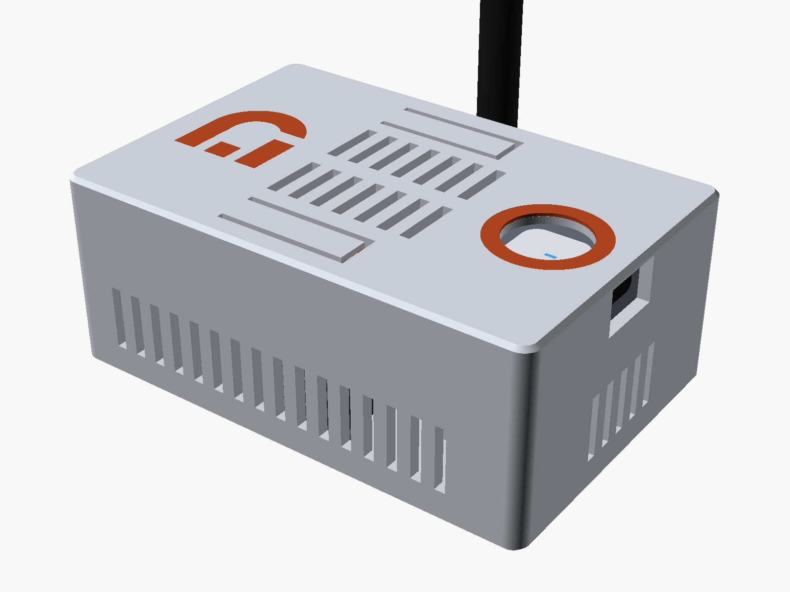
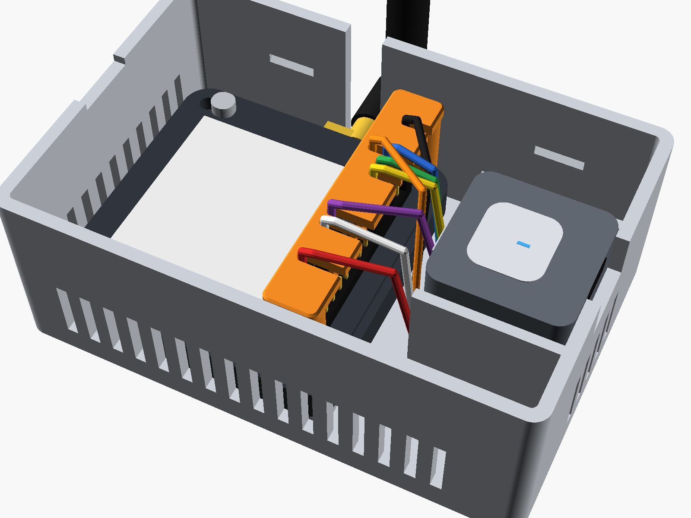
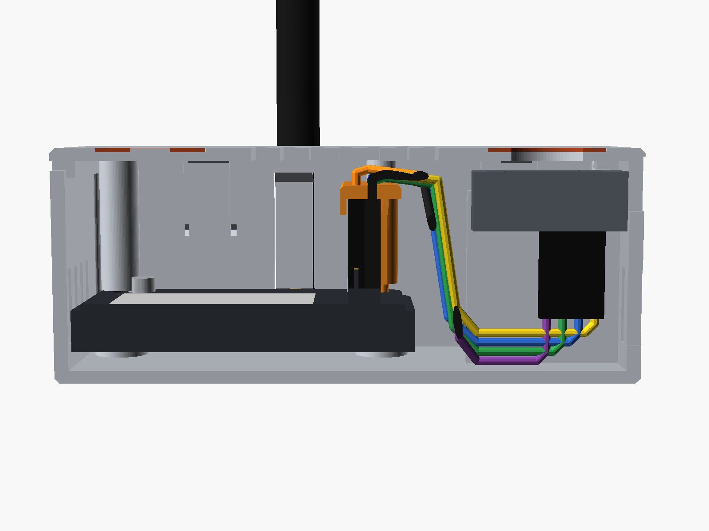
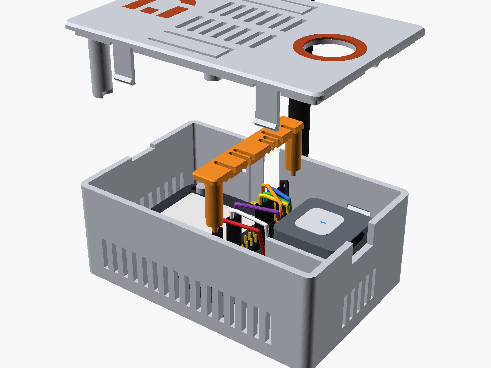
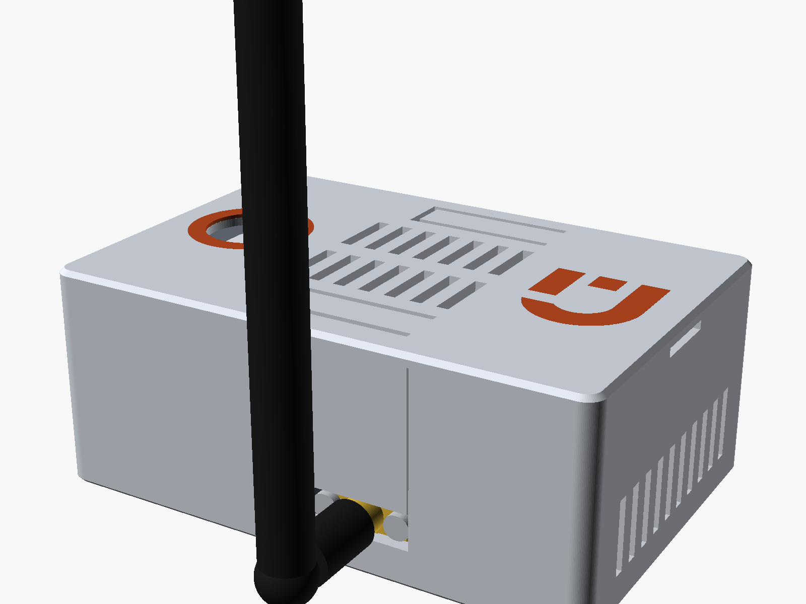
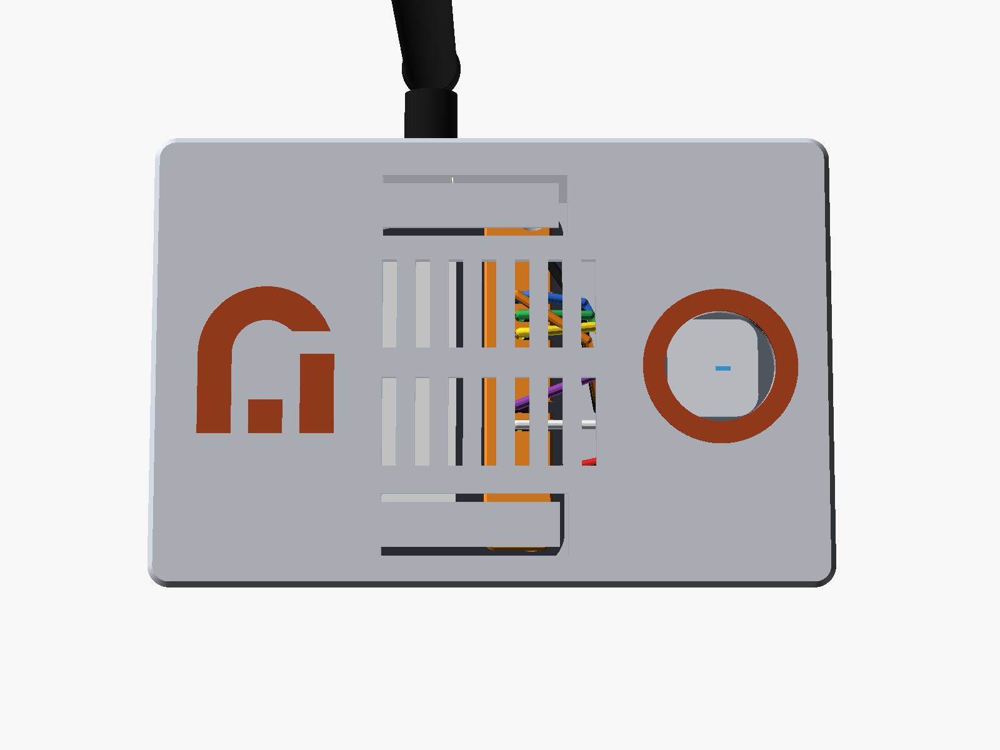
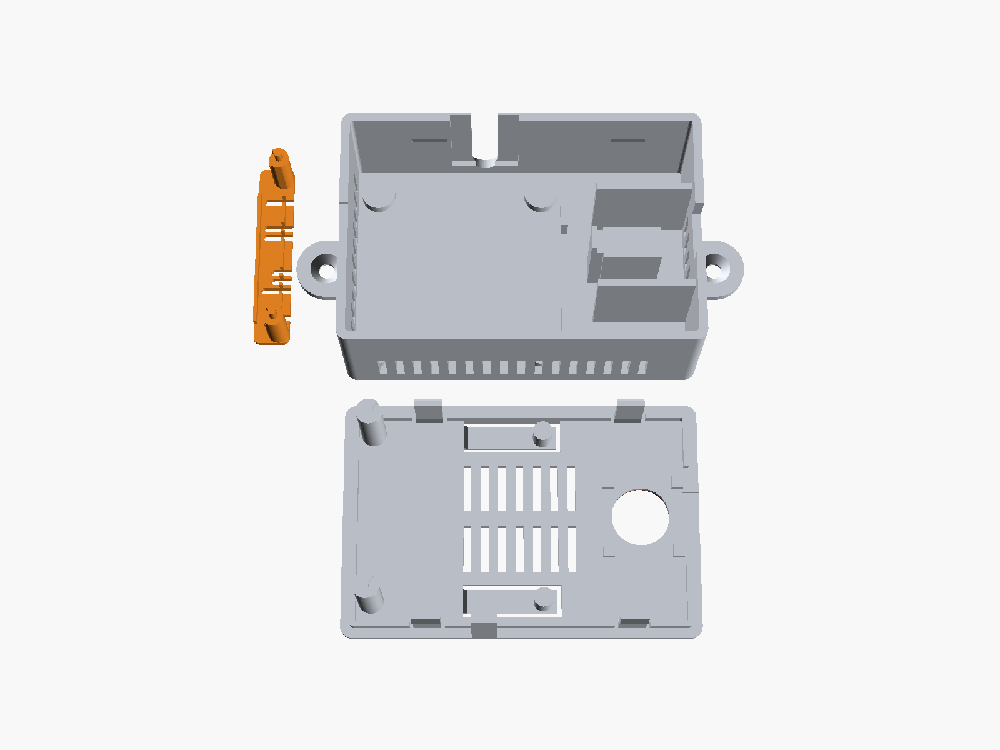
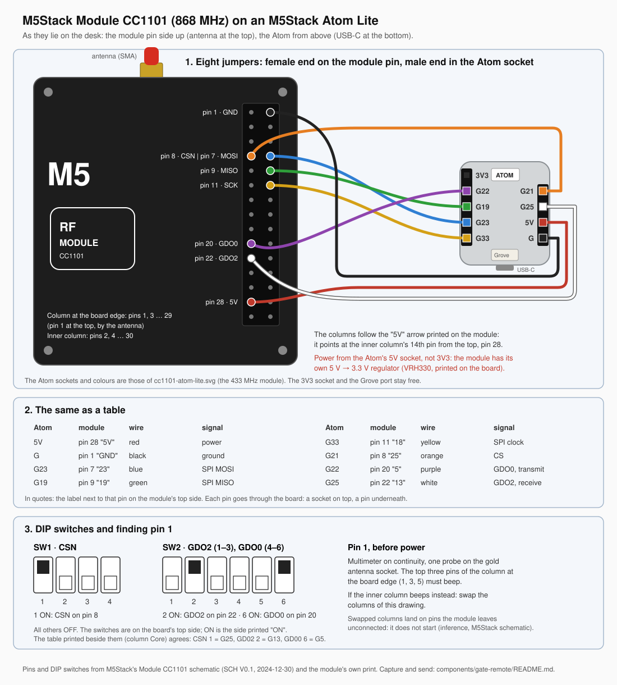

# Enclosure: M5Stack Module CC1101 and Atom Lite

A printable box for an M5Stack Atom Lite wired to an M5Stack Module CC1101 855–925 MHz
(SKU M146) with eight Dupont jumpers: the node of the
[`gate-remote`](../../../components/gate-remote/README.md) component, which sends a fixed-code
868 MHz gate handset's signal. Wiring and setup:
[the module's guide](../../m5stack-module-cc1101.md). Three parts, no supports, no screws: the lid
snaps on.



| Open | Section through the clamp |
|---|---|
|  |  |
| **Exploded** | **Antenna side** |
|  |  |
| **From above, with the logo** | **Print plate** |
|  |  |

Outside 92.3 × 61.2 × 37 mm; the wall-mount base is 120.3 mm wide with its ears.

- **Module.** It lies pin face up on four pads under its corners; the left wall, two low stops on
  its right side and the SMA slot locate it. Underneath it is an open shell, and each pad carries
  a corner of its rim. Its SMA jack passes through a slot in the back wall, and the
  antenna is bent upright on its hinge. The two screws of the jack's flange stand 1.1 mm into
  the wall; a groove in its inner face, open to the top, takes their heads down as the module
  drops in, and the wall stays closed outside it (0.75 mm). A tongue on the lid fills the slot
  above the jack.
- **Corner screws.** Beside each corner hole, 3.3–3.8 mm towards the middle, an M2 socket screw
  holds the board to its frame, its head about 2 mm proud of the pin face. M5Stack's drawing does
  not show them; the first printed clamp caught on them. The clamp's pins (Ø2.2 mm) sit 0.25 mm
  off the holes' centres, away from the screws, and the clamp's bosses and the lid's tubes have
  notches over the heads. The model sweeps each head over its measured range of positions, so its
  clash checks cover every one of them.
- **Jumpers.** The module's header pins stand only 3.0 mm above their plastic spacer, so a
  female Dupont housing grips them shallowly and works loose. The clamp is a bar with one slot
  per jumper. It slides over the wires from the Atom's side and sits on the eight housings, and
  its two pins locate it in the module's holes. Two spring flaps cut into the lid press it down,
  so the housings stay on the spacer. The flaps take up ±1 mm of housing length without
  adjustment. While they press, they stand 0.5–2.5 mm proud of the lid's top (1.5 mm with housings of the
  clamp's nominal length, 14 mm for `clamp` and 12 mm for `clamp_12mm`). Skirts on both sides of the clamp keep the housings upright.
- **Atom.** It stands on a pedestal between its two rows of plugs, button up, with USB-C through
  the right wall. A stop on the module side, joined to the pedestal, keeps it off the jumpers.
  Pads on the lid hold its corners down.
- **Button.** It sits at the bottom of a Ø15 mm well, 3.4 mm below the lid. A deliberate press
  with a fingertip reaches it; a hand resting on the box or an object set on it does not. The
  well does not stop a child. The LED shows through the well. An optional ring around the well
  prints in a second filament.
- **Lid.** Four latches snap into V-grooves in the front and back walls. The lid presses on and
  pulls off by hand, starting with a fingernail in the notch on the left wall.
- **Vents.** 2 mm slots in the lid and in the front, left and right walls, too narrow for a
  finger. The node draws about 0.5 W (estimate, not measured), so it does not need them to stay
  cool. `vents = false` removes them.
- **Logo.** The DomoSenso.org symbol, 20 mm high, is recessed 0.6 mm into the lid left of the
  vents. It reads upright both on a shelf and on the wall. Printed in one colour it is an
  engraving; with a second filament it is a flush terracotta inlay, together with the ring.
- **Wall mount.** `base_wall` adds two ears. Hang the box with the antenna side up, and the
  antenna stands straight without bending.

## Files

| File | What | Print orientation |
|---|---|---|
| `3mf/base.3mf`, `stl/base.stl` | base for a shelf | open side up |
| `3mf/base_wall.3mf`, `stl/base_wall.stl` | base with two wall-mount ears | open side up |
| `3mf/lid.3mf`, `stl/lid.stl` | lid | top face down |
| `stl/lid_inlay_parts.stl` | ring around the button well and the logo, second filament (optional) | with the lid |
| `3mf/clamp.3mf`, `stl/clamp.stl` | jumper clamp, for 14 mm female housings | flat face down |
| `3mf/clamp_12mm.3mf`, `stl/clamp_12mm.stl` | the same clamp for 12 mm female housings, 2 mm thicker; fits the same base and lid | flat face down |
| `enclosure.scad` | parametric source (OpenSCAD) | |
| `build.py` | exports `stl/` and `preview/` | |

Print one base (shelf or wall), one lid and one clamp: `clamp` or `clamp_12mm`, as your jumpers'
female housings measure ([Before the first print](#before-the-first-print)). The `.3mf` files are Bambu Studio projects
for the P2S with the settings below applied; open those first. The STLs are for other slicers.

## Hardware

| Qty | Part | For |
|---|---|---|
| 8 | Dupont jumper, female–male, one batch, at least 8 cm of wire between the housings (10 cm jumpers usually; 15 cm if the 10 cm ones are shorter) | module pins to Atom sockets |
| 2 | countersunk wood screw, 3.5–4 mm, with wall plugs | `base_wall` only |

## Printing

Bambu Lab P2S (Combo with AMS 2 Pro), 0.4 mm nozzle. Every part fits the 256 × 256 × 256 mm build
volume; base, lid and clamp fit one plate.

| Setting | Value |
|---|---|
| Material | PETG (e.g. Bambu PETG HF), because the latches and flaps flex. PLA works too: the model asserts their strain stays under PLA's limit. The 3MFs open on PLA Basic, the printer's default filament; switch it in Bambu Studio. |
| Process | 0.20 mm Standard @BBL P2S. Keep 0.20 mm layers: the flaps are 5 layers, the ring and the logo 3. |
| Wall loops | 5 (2.25 mm walls print solid) |
| Sparse infill | 15 %, gyroid |
| Supports | off. Nothing overhangs past 45°; vent tops are 2 mm bridges. |
| Brim | none |

PETG: about 240 °C nozzle, 70–80 °C bed, dried filament.

Second colour for the ring and the logo (optional): select `lid.stl` and `lid_inlay_parts.stl`
together and load them, or add `lid_inlay_parts.stl` as a part to the opened `lid.3mf`. When
Bambu Studio asks whether to load the files as one object with multiple parts, answer yes. Assign
the second filament to `lid_inlay_parts`; only the first three layers (0.6 mm) change filament.
The brand book's framework colour is terracotta (#AD431F); the filament closest to it needs a
test print, since the HEX value is a screen colour. Without the second filament, print the lid
alone: the logo stays an engraving and the ring a 0.6 mm groove (`accent = false` removes the
groove).

## Wiring

Eight female–male jumpers, female ends on the module's pin side, male ends in the Atom's sockets.
From [the module's guide](../../m5stack-module-cc1101.md), which also sets the module's DIP
switches and covers the first start.



| Atom Lite socket | module M-Bus pin | signal | wire |
|---|---|---|---|
| G | 1 | ground | black |
| 5V | 28 | power | red |
| G23 | 7 | SPI MOSI | blue |
| G19 | 9 | SPI MISO | green |
| G33 | 11 | SPI clock | yellow |
| G21 | 8 | CSN | orange |
| G22 | 20 | GDO0, transmit data | purple |
| G25 | 22 | GDO2, receive data | white |

Power the module from 5V, never 3V3: it has its own 3.3 V regulator. The labels printed on the
module's top side are GPIOs of M5Stack's Core controllers, not the Atom's; go by the pin numbers.
The clamp's slots follow `pins_used` (`[1, 7, 8, 9, 11, 20, 22, 28]`), the eight pins above.

## Assembly

1. Put the module in the base, pin face up, with the SMA jack down in the slot of the back wall,
   on the four pads and against the left wall.
2. Plug the female ends onto the module's pins and the male ends into the Atom's sockets, as
   [Wiring](#wiring) says. Push every female housing down until it sits on the black spacer.
3. Set the Atom on its pedestal, button up, with USB-C facing the opening in the right wall. The
   jumpers run down the channel beside the module and under the Atom.
4. Hold the clamp about 3 mm above the housings and slide it in from the right, one wire per
   slot. Lower it onto the housings so that its two pins drop into the module's right-hand corner
   holes, with the notches of its bosses over the screw heads beside them. Then bend the wires over
   towards the Atom. The clamp fits one way round only: the open ends of its slots face the Atom,
   and the notches at the foot of its bosses face the module's middle. Turned round, its bosses
   stand on the screw heads.
5. Put the lid on: tongue into the slot above the jack, well over the button. Press until the
   four latches click.
6. Screw the antenna onto the jack and bend it upright.

To open the box, put a fingernail in the notch on the left wall and lift the lid.

## Changing it

The parameters at the top of `enclosure.scad` show in OpenSCAD's Customizer, or set them with
`-D`. Its DESCRIPTION header maps each feature to its parameters.

| Parameter | Default | Meaning |
|---|---|---|
| `pins_used` | `[1, 7, 8, 9, 11, 20, 22, 28]` | module M-Bus pins with a jumper; the clamp gets one slot per pin |
| `wire_d` | 1.4 | jumper wire diameter |
| `dupont_len`, `dupont_tol` | 14.0, 1.0 | Dupont housing length the box is made for, and the variation the flaps take up |
| `clamp_housing_len` | `dupont_len` | female housing length under the clamp; shorter, the clamp's bar grows down and the box stays (`clamp_12mm` is 12). Its default is an expression, so set it with `-D` or in the file; the Customizer does not list it |
| `well_d`, `well_depth` | 15, 3.4 | button well; the depth also leaves 1.3 mm of lid over the USB opening |
| `accent`, `accent_od`, `accent_t` | true, 21, 0.6 | ring around the well |
| `usb_plug_w`, `usb_plug_h` | 13, 8.5 | opening for the USB-C plug body |
| `vents`, `vent_w`, `vent_len` | true, 2, 12 | vent slots |
| `logo`, `logo_h`, `logo_depth` | true, 20, 0.6 | DomoSenso.org symbol on the lid; `logo = false` gives the lid its full grid of vents back |
| `e_modulus`, `strain_limit` | 2100, 1.2 | material for the latch and flap checks (PLA: 3500) |
| `ear_hole_d`, `ear_head_d` | 4.2, 8.5 | wall-mount screw hole and countersink |
| `screw_dx`, `screw_y_tol`, `screw_head_d`, `screw_head_h` | [3.3, 3.8], 0.2, 4.0, 2.4 | the module's corner screws: range of the head's centre from the hole's centre towards the middle, its offset across, and the largest head the notches clear |

The file asserts its functional claims: room for the plug bends under the Atom, latch and flap
strain, latch hold against the flaps, the clamp's rib width, the latch grooves leaving at least
two lines of wall, the clamp pins' clearance to the nearest screw head and to their holes, the
notches staying clear of the pins, the material left above the notches, and the logo's clear
space, whole-layer depth and the lid left under it. A change that breaks one stops the render with a message.

Rebuild the STLs and previews with:

```bash
uv run build.py
```

Pass parameters on as `-D`, for example `uv run build.py -D 'vents=false'`. It needs OpenSCAD
with the Manifold backend (2025 or newer); on macOS install it with
`brew install --cask openscad@snapshot`. It finds OpenSCAD through `$OPENSCAD`, `PATH`, or
`/Applications/OpenSCAD.app`.

The checks and the 3MFs come from the
[3d-print-designer](https://github.com/wilsonwaters/3d-printing) skill's tools
(commit `f5e18a1`):

```bash
python3 <skill-dir>/verify-model.py enclosure.scad --build-volume 256x256x256
```

```bash
python3 <skill-dir>/make-bambu-3mf.py --scad enclosure.scad -D 'part="lid"' --printer P2S --layer-height 0.2 --walls 5 --infill 15 --infill-pattern gyroid --supports off --scatter off --out 3mf/lid.3mf
```

The clamp for 12 mm housings is the clamp part with its own value (`build.py` exports its STL
when it runs without `-D`):

```bash
python3 <skill-dir>/make-bambu-3mf.py --scad enclosure.scad -D 'part="clamp"' -D clamp_housing_len=12 --printer P2S --layer-height 0.2 --walls 5 --infill 15 --infill-pattern gyroid --supports off --scatter off --out 3mf/clamp_12mm.3mf
```

Two design reviews by separate agents followed the skill's brief, first on Sonnet, then a final
one on Fable (claude-fable-5-1). Neither found a blocker, and the fixes from both are in:
- the flap preload covers short housings;
- the flap hinges and the latch roots have 45° ramps and gussets;
- the groove sits lower, so the lid cannot float;
- the clamp ribs are wider and its skirts shorter;
- the lid's tongue has 0.3 mm of play per side in the antenna slot;
- the lid over the USB opening is 1.3 mm thick;
- the flap slots are 1.2 mm wide.

Last gate run: `GATE: PASS (18 of 18 parts pass)`. Every printed part is one manifold body on the
plate with no overhang past 45°, and all eight `clash_*` checks are empty: lid and base, clamp
and lid, clamp and base, each printed part against the boards, the inlays in their recesses, and
the jack's flange screws on their way down the back wall's groove.
The logo, added after the reviews, had a lightweight check only (gate and the outline comparison
below), no new design review.

`clamp_12mm` (6 November 2026): the gate with `-D clamp_housing_len=12` on the clamp, its three
`clash_*` checks and the views passed 8 of 8, with the female housings modelled at 12 mm. Sunk
1 mm (11 mm housings), the clamp clears the module and the screw heads (0.3 mm under the notch
ceilings, the designed `head_clear`) and meets the lid only at the flap nubs, 0.5 mm deep: the
designed spring contact. The default `clamp.stl` is byte-identical to the one before. A Sonnet
design review (claude-sonnet-5-5) found no blocker; its documentation findings are in.

The corner-screw fix had its own review on Sonnet (claude-sonnet-5-5). It found that the first
version cleared the heads only at the middle of the measured range; the heads are now swept over
the whole range, and the clamp's pins are thinner and off-centre. Without the notches, the clash
checks report the overlaps the first print met: 0.9 mm at the clamp, 2.0 mm at the lid.

## Sources

- Module CC1101: [product page](https://docs.m5stack.com/en/module/Module_CC1101) (54.0 × 63.6 ×
  13.1 mm, antenna 110 × 8 mm) and
  [model-size drawing](https://m5stack-doc.oss-cn-shenzhen.aliyuncs.com/1188/M135-and-M146-model-size-GNSS-1.pdf).
  The drawing is a 1:1 vector PDF; its outline, holes, pins and jack were measured from the
  vectors:
  - body 6.6 mm at the edge, 7.6 mm with the plateau on the pin face;
  - header spacer top 10.1 mm and pin tips 13.1 mm above the underside;
  - header columns 44.8 mm and 47.3 mm from the left edge, centred along the edge;
  - corner holes Ø3.1 mm, 5 mm from the edges;
  - SMA axis 34 mm from the left edge and 3.75 mm above the underside, protruding 9.6 mm, with a
    flange 14 × 1.8 × 5.7 mm.

  The drawing leaves out the two screws that hold the flange to the frame. Measured with a ruler
  on one module (6 November 2026): heads Ø4 mm, standing 1.5 mm proud of the flange, 12 mm apart
  centre to centre. The usual spacing of a two-hole SMA flange is 12.7 mm (½ in); the slot takes
  heads anywhere from 12 to 12.7 mm apart.

  The drawing spaces the header pins 2.50 mm apart. The model uses the M-Bus pitch of 2.54 mm.
- Corner screws: not in the drawing. The first printed clamp (5 November 2026) caught on them.
  Measured on M5Stack's top-view product photo of the module, scaled by its 54 mm width (595 px):
  - corner holes 5.0 and 49.0 mm from the left edge, as drawn;
  - four M2 socket screws, heads Ø3.8–4.0 mm, centres 3.3–3.8 mm from the hole centres towards
    the middle and within 0.2 mm of the holes' line;
  - head height not measured: 2.0 mm for an M2 socket cap, about 2.2 mm in a side photo of the
    module.

  Photos of the module itself, from above and below, show the same screws and an open shell
  underneath: the corner holes go through the board, the screws into posts of the frame.
  Measured with a ruler on one module (6 November 2026): 54 mm each side, corner holes 44 mm apart
  centre to centre, 7.5 mm from the underside to the board's top face; the drawing gives 54, 44
  and 7.6 mm. The antenna jack's thread measured 32 and 37 mm from the module's left
  edge, so its axis is 34.5 mm from it, against the drawing's 34; the two edges span 5 mm of a
  6.35 mm thread, so the ruler reading is good to about ±0.5 mm. Laid open side down on a flat table, the module rests
  level on its rim: the screw posts, the corner bosses and the bus socket inside it stay within
  the rim, so on the pads it stands at the modelled height.
- Atom Lite: [product page](https://docs.m5stack.com/en/core/ATOM%20Lite) (24.0 × 24.0 × 9.5 mm),
  [model-size drawing](https://m5stack.oss-cn-shenzhen.aliyuncs.com/resource/docs/products/core/ATOM%20Lite/model%20size.jpg)
  and [Atom-Lite.stl](https://github.com/m5stack/M5_Hardware/tree/master/Products/C008_Atom-Lite/Structures).
  The drawing is a raster image, so its numbers were measured from pixels, about ±0.2 mm:
  - header sockets on the underside, 4.5 mm from the side edges;
  - socket rows 9.5 to 19.6 mm from the face opposite the USB-C;
  - the USB-C axis 2.15 mm below the top face.
- Dupont housing 14 mm and wire 1.4 mm: common values. The jumpers of the first build measured
  12 mm (ruler, 6 November 2026), hence `clamp_12mm`; the wire was not measured.
- Logo: the DomoSenso brand book 1.0 (5 November 2026,
  [`branding/brand-book.md`](../../../branding/brand-book.md)): on a casing only the symbol, about 20 mm, one structural width (12 of
  52 units, 4.6 mm) of clear space, no rotation or stretching. The model builds the outline from
  the construction in `branding/geometry.json`, because OpenSCAD 2026.10 imports the master
  `branding/assets/symbol-20mm.svg` shifted by 12 units (it applies the viewBox offset twice).
  Checked against that master at commit `5703286`: aligned, the two outlines differ by
  less than 0.01 mm in either direction.
- Latch and flap forces are cantilever estimates with E = 2100 MPa (PETG) and 0.3 friction,
  not measurements.

## Before the first print

- Measure the black plastic of one female jumper end. About 14 mm: print `clamp`; about 12 mm:
  print `clamp_12mm`. The base and the lid are the same for both. Each clamp takes 1 mm either
  way; for another length set `clamp_housing_len` (up to `dupont_len`) and rebuild the clamp.
- Measure a jumper's wire across its insulation. The clamp's slots are `wire_d + 0.3` wide and
  print at about the wire's diameter, with `wire_d = 1.4`. Set `wire_d` to the measured value
  and rebuild. Above 1.44 mm the ribs between neighbouring slots get too thin, and the model
  stops with an error. Without a caliper, print the clamp first (a few minutes) and check that
  the wires slide into its slots.
- After printing the lid, press each spring flap from the underside: it must move. A flap fused
  at its first layer pushes nothing.

## Not verified

- Only the clamp has been printed, twice, in eSun PETG-CF on a Bambu Lab P2S (20 minutes each,
  clean). The first, on 5 November 2026, did not seat on the module: its bosses caught on the
  corner screws. The second seats on the module the right way round (checked on 6 November 2026
  without the box; turned round it does not, as step 4 says). With 12 mm housings under it, it
  rested on its bosses: nothing would have pressed the housings. `clamp_12mm` is for those; it
  has not been printed. Still to check:
  - the clamp on its pins and housings inside the box, with the lid's flaps pressing it;
  - the module on its pads;
  - the lid closing over the left-hand screw heads, the latch click and how hard the lid pulls off;
  - the USB-C plug in its opening.
- The first base, printed on 6 November 2026 in PETG-CF (39.8 g, about 1 h 25 min), did not
  take the module: the drawing has no flange screws, so their heads stood on the back wall's inner
  face. The back wall now has a groove on its inside, 17.8 mm wide and 1.5 mm deep, from 6.35 mm
  above the base's underside to the rim (`clash_sma_heads_path` checks the way down); 0.75 mm of
  wall stays outside it. This base is not printed yet. A base printed before the change takes the
  same groove, 27.85 to 45.65 mm from the outside of the left wall (the wall with the pry notch):
  ground out from the inside, or cut through the wall, which is easier by hand and leaves an
  opening each side of the lid's tongue. Either way 1.1 mm of wall stays beside the left latch's
  groove.
- In the first base, pins on the pads (Ø2.8 mm, 2.5 mm tall, into the 3.1 mm corner holes from
  below) kept the module from sitting down, and nothing stood on its right side to hold it. The
  pins are gone; two stops on its right side (8 mm wide, 4 mm up its side) hold it against the
  left wall with 0.3 mm of play. Not printed yet. In a base printed earlier, cut the pins off
  flush with the pads; double-sided tape on the pads then holds the module.
- The module's place across the box: the left wall leaves it 0.5 mm, the stops 0.3 mm, and the
  jack in its slot about ±0.2 mm around the drawing's position. Shifted 0.4 mm left or 0.5 mm
  right, the lid's tubes still clear the corner screws (checked by moving the module in the
  model); against the left wall, 0.5 mm left, they touch them. That happens only if the jack sits
  0.3 mm or more further right on the module than drawn, which the ruler reading allows.
- The Atom's stop on the module side stood alone in the first base, a 1.35 mm plate 26 mm tall
  held only by the floor; a web now joins it to the pedestal. Not printed yet.
- The screw positions come from a photo. Over the whole measured range, with a head of up to
  4.0 × 2.4 mm, the notches leave 0.3 mm (0.45 mm as modelled, before the printed-hole shrink),
  also with the clamp 1 mm lower on short housings; the clamp's pins pass at least 0.45 mm from a
  head and sit 0.2 mm inside their holes. A head outside that range, or taller than 2.4 mm, needs
  new `screw_*` values. Checked by inflating the modelled heads: 0.44 mm clears, 0.6 mm collides.
- The latch tabs stand upright in print, so they bend across the layers. Their strain (0.9 %) is
  low for PETG and under PLA's limit, but layer bonding varies between printers.
- Jumper length: the routes in the model need 6–7 cm of wire plus bends. Jumpers sold as 10 cm
  fit if the wire between the black housings is at least 8 cm.
- The clamp presses the tallest housings; mixing jumper batches can leave a shorter one loose
  (still on its pin).
- About 5 mm of the SMA jack's thread sticks out past the back wall; the antenna's nut has to seat
  fully on it.
- The 0.84 mm ribs between neighbouring clamp slots should show as two lines in Bambu Studio's
  preview. The short posts of the clamp's right-hand skirt between neighbouring slots may print
  rough or break off; the clamp works without them.
- A bulky USB-C plug body may need `usb_plug_w` / `usb_plug_h` raised.
- The button well's depth is a judgement: 3 mm stops casual presses, and a deliberate press
  should still reach the button. Press a palm flat on the lid over the well: if the Atom's LED
  reacts or the gate opens, raise `well_depth` to 4 (the Atom moves down; the room under it is
  asserted).
- Printed in one colour, the logo's engraving floor is the first layer above the recess,
  bridged over the symbol's shape; it may look rougher than the inlay version.
- The lid's tongue over the antenna jack is its tallest feature (25.8 mm) and prints its last
  layers alone; the slicer's minimum layer time decides how clean its tip comes out.
