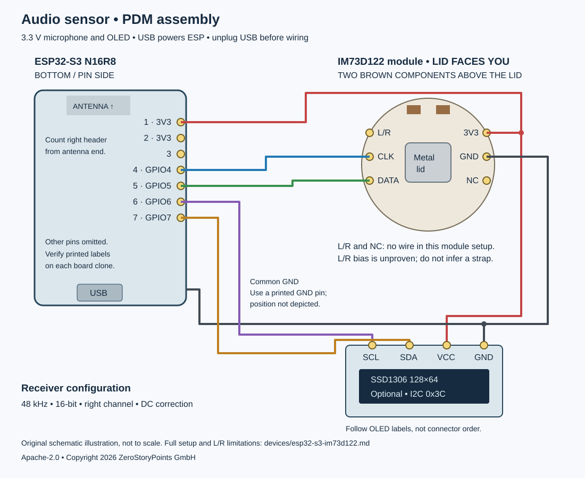

# ESP32-S3 with IM73D122: assembly and first start

This is the second audio-sensor assembly, introduced in **0.5.0 (unreleased)**: an
ESP32-S3 DevKitC-1 N16R8-compatible board (16 MB flash, 8 MB octal PSRAM), the round
IM73D122 PDM microphone module described below, and optionally a 3.3 V-compatible
SSD1306 128x64 I2C OLED at address `0x3C`. USB powers the development board. The microphone
and display take **3.3 V, never 5 V**, with common ground.

The assembly uses the existing audio-sensor FFT, sound levels, octave summaries and controls.
No speaker, ES8311, amplifier output, Bluetooth or LED strip is configured. The microphone
has no programmable gain; Home Assistant's Mic gain reports `Fixed PDM (no programmable gain)`.

## Identify the boards before wiring



The ESP drawing is the **bottom / pin side**, with **antenna at top and USB at bottom**.
Count each header from the antenna end. On the tested layout the right header has 3V3 at
positions 1 and 2, GPIO4 at 4, GPIO5 at 5, GPIO6 at 6 and GPIO7 at 7. Check printed GPIO
labels on clones; position alone does not establish a clone's pinout. Use a printed GND pin;
the drawing deliberately does not infer its header position.

The microphone view is **metal lid towards you, with the two brown components above the lid**.
It has two three-pin headers. A different PCB advertised under the same chip name needs its own
pin verification; the chip marking alone is not a module pinout or authenticity check.

| Microphone position in that view | Connect to |
| --- | --- |
| Right top | 3V3 |
| Right middle | GND |
| Right bottom | NC: leave unconnected |
| Left top | L/R: left unconnected on the verified module |
| Left middle | CLK: GPIO4 |
| Left bottom | DATA: GPIO5 |

| Optional OLED label | ESP connection |
| --- | --- |
| VCC | 3V3 |
| GND | Common GND |
| SCL | GPIO6, right header position 6 |
| SDA | GPIO7, right header position 7 |

OLED connector order varies; follow its printed signal names. Unplug USB while changing wires.
Do not add GPIO15/16 probes, supply cycling or automatic pin discovery to this firmware.

### L/R is a module-specific observation

The verified module worked with its L/R header unconnected and the receiver set to `right`.
Its internal bias has **not** been established. This does not mean floating L/R is valid on
all modules or on a bare chip, and an `R` marking does not prove a bias circuit.

The [Infineon IM73D122 datasheet, section 3.5](https://www.infineon.com/assets/row/public/documents/24/49/infineon-im73d122-datasheet-en.pdf)
uses L/R at GND or VDD to choose the data-driving clock edge: GND selects the falling edge,
VDD the rising edge. L/R is not another audio input. Check the actual PCB and datasheet before
recommending a permanent strap; this guide makes no strap or pull-up recommendation.

## Configure a new installation

Prerequisites: a home repository, the released audio-sensor tag, ESPHome **2026.9.1**, a USB
data cable and a toolchain host with network access for ESPHome packages/toolchains. The optional
OLED font (`Roboto`) is downloaded through ESPHome's Google Fonts support and cached locally.
Do not use the 0.5.0 URLs until that tag is published. Before release, use the local test command below.

Add this sensor to the home's audio-sensor inputs:

```yaml
sensors:
  - room: office
    area: Office
    board: esp32-s3-im73d122
    oled: true
```

Omit `oled` or set it to `false` when no display is wired. Do not supply `mic_gain` or `strip`:
both are rejected for PDM. Missing/null `board` means Atom; missing/null `oled` means false.
For a new component installation, `domosenso add audio-sensor@0.5.0` writes the thin file once.
On an existing installation, follow the component's [upgrade notes](../components/audio-sensor/UPGRADE.md)
and create/edit the new owner-managed file explicitly. Inputs never rewrite an existing thin file.

The resulting file is like [the display example](../examples/demo-home/esphome/audio-sensor-hall.yaml)
or [the display-free example](../examples/demo-home/esphome/audio-sensor-office.yaml). Supply
`wifi_ssid`, `wifi_password` and `api_encryption_key` in the home's ESPHome secrets. Keep secrets
and installation calibration out of the catalog. Pin all package URLs to the same released version.
If local wiring differs, explicitly override the corresponding ESPHome IDs/pins in the thin file
and validate the complete file; the generic component does not allocate arbitrary pins.

Validate, then compile without touching a device:

```sh
uvx --from esphome==2026.9.1 esphome config esphome/audio-sensor-office.yaml
uvx --from esphome==2026.9.1 esphome compile esphome/audio-sensor-office.yaml
```

With the owner's authorization and the intended USB port identified, first flash with
`uvx --from esphome==2026.9.1 esphome run esphome/audio-sensor-office.yaml --device <USB-port>`.
Use the board's BOOT/reset procedure for download mode. Keep a known working firmware and its
configuration for rollback. Do not flash another board merely because it is the first serial port.

### Factory provisioning alternative

The manifest's default factory is still **Atom**. For this assembly explicitly compile/flash
`components/audio-sensor/esphome/audio-sensor-pdm.factory.yaml` from a released catalog checkout:

```sh
uvx --from esphome==2026.9.1 esphome compile components/audio-sensor/esphome/audio-sensor-pdm.factory.yaml
# Only with authorization and the intended port selected:
uvx --from esphome==2026.9.1 esphome run components/audio-sensor/esphome/audio-sensor-pdm.factory.yaml --device <USB-port>
```

It offers Improv serial and fallback AP provisioning; its dashboard import selects the PDM package.
After Device Builder adoption add `esphome.area` and authenticated OTA (`encryption:` inheriting the
API key), as in the thin example. Factory firmware assumes no OLED; add its package to the adopted
file when wired. Home Assistant uses its normal ESPHome integration. The expected manufacturer/model
is `domosenso` / `audio-sensor-pdm`; this remains an inference until actual HA metadata is recorded.

## Display and acceptance

The OLED uses 400 kHz I²C and refreshes twice per second. Full-frame transfers are synchronous;
the faster bus reduces stalls in spectrum publication without changing FFT processing or the
one-second sound measurement window. `Now` is the current one-second RMS level in dBFS;
`Max` holds the highest finite one-second peak seen since boot, resetting at restart.
Startup/non-finite data displays `--` and never poisons the held maximum. The bar clamps
-100..0 dBFS to the display width. Home Assistant **Sound peak remains the current one-second
window**, not the held display maximum. Neither number is calibrated SPL.

Bench evidence before 0.5.0: two modules produced finite, sound-responsive PDM readings at
48 kHz, 16-bit with DC correction after correcting orientation. N16R8 memory and OLED worked.
Earlier no-data trials used the wrong orientation and do not establish faulty microphones.
The shared FFT firmware has also produced 31 finite spectrum bands in eco, normal and fast
for at least 60 seconds each on the N16R8 bench, with the OLED enabled. Sound response and
the display's held maximum were confirmed. This was an offline UART test, not a Home Assistant
installation: direct octave-entity updates, HA metadata and calibrated frequency response still
need acceptance; tested homes: 0.

After authorized flashing, record firmware commit/tag, board/module identity, configuration and
run duration. For **at least 60 seconds at each of eco, normal and fast**, check sound response,
31 finite spectrum bands, octave updates, rate changes and Spectrum load. Repeat with the OLED,
confirm its held maximum survives lower peaks, and verify reset clears the hold. Confirm HA
device metadata and unchanged entity semantics. Preserve logs privately and publish only a
sanitized acceptance summary. Check clipping and calibrate with a reference before describing
levels as SPL. The 4096-point FFT's low bands share bins; no calibrated 20 Hz accuracy is claimed.

Before release, maintainers can reproduce all config/compile cases without devices or public tags:

```sh
tools/esphome-check.sh audio-sensor compile audio-sensor-kids-room.yaml audio-sensor-living-room.yaml audio-sensor-office.yaml audio-sensor-hall.yaml audio-sensor-pdm.factory.yaml
```

This builds isolated local package remotes and fake secrets. It does not flash hardware.

## If there is no sound or display

Check the exact viewing orientation first, then common ground, printed 3V3 and GPIO labels,
CLK4/DATA5 and the receiver's right channel. Do not infer a defective module from silence.
Check the OLED's printed SCL/SDA labels, 3.3 V compatibility and `0x3C` address. A missing OLED
must not be used as evidence about microphone operation; use the display-free configuration.
