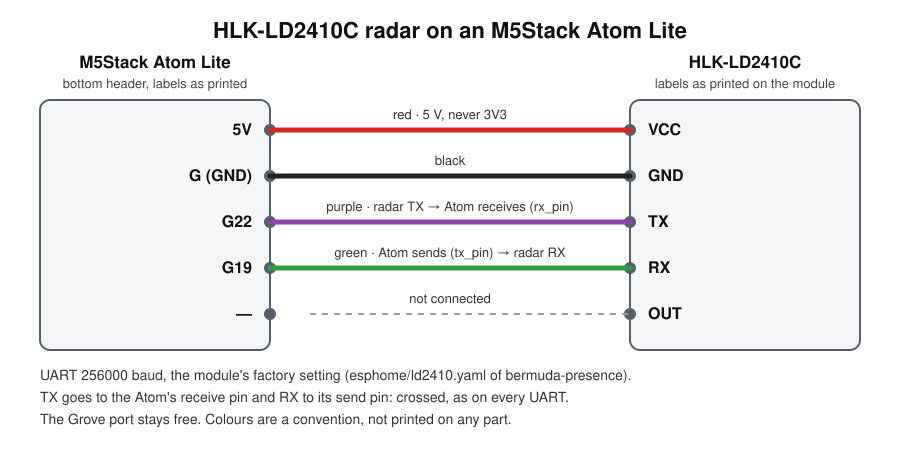

# HLK-LD2410C radar: wiring and setup

A Hi-Link HLK-LD2410C 24 GHz presence radar on an M5Stack Atom Lite that already runs as a
`bermuda-presence` BLE proxy. It is that component's optional feature `radar`; the Ramka uses a
radar like this to wake its screen. Device file: [hlk-ld2410c.yaml](hlk-ld2410c.yaml).

## Wiring



| Atom Lite (bottom header) | HLK-LD2410C | wire | why |
|---|---|---|---|
| 5V | VCC | red | the module needs 5 V; **never 3V3** |
| G | GND | black | |
| G22 | TX | purple | the Atom receives on G22 (`rx_pin: GPIO22`) |
| G19 | RX | green | the Atom sends on G19 (`tx_pin: GPIO19`) |
| — | OUT | — | not connected: presence comes over the UART |

Source: `components/bermuda-presence/esphome/ld2410.yaml`, the wiring of the first home's boards.
The labels are the ones printed on the Atom and on the module; the diagram shows which socket goes to
which pin, not where they sit on the boards. Colours are a convention: any colour works if both ends
match. The Grove port stays free.

## Firmware

The board's thin device file pulls the radar package next to the proxy package; with
`radar: true` on that proxy in the component's inputs, `domosenso add` writes it so (SPEC-015):

```yaml
packages:
  proxy: github://zerostorypoints/domosenso/components/bermuda-presence/esphome/ble-proxy.yaml@bermuda-presence/<version>
  radar: github://zerostorypoints/domosenso/components/bermuda-presence/esphome/ld2410.yaml@bermuda-presence/<version>
```

Then `esphome config`, `compile` and a flash, as for any proxy (`components/bermuda-presence/README.md`).
The UART runs at 256000 baud, the module's factory setting.

## After the first start

- The module keeps its settings (gates, thresholds, timeout, its own Bluetooth) in its own flash:
  set them once from Home Assistant; they survive a reflash of the Atom.
- Engineering mode is the one setting it forgets on a restart, and the light reading only comes in
  engineering frames, so the package switches it back on 10 s after every boot.
- New entities on the proxy's device: presence, moving and still target, detection distance and
  the others listed under `features.radar` in `components/bermuda-presence/component.yaml`.

## When it does not work

| what you see | likely cause |
|---|---|
| no radar entities at all | the device file lacks the `radar:` package line |
| radar entities `unavailable` or never changing | TX and RX swapped (TX must go to G22), or VCC on 3V3 |
| the Atom resets or drops off Wi-Fi when the radar is plugged in | a weak USB supply: the radar draws its power through the Atom; use a plain 5 V USB supply (the `power` note on `ble-proxy` in `components/bermuda-presence/component.yaml`) |
| presence that never clears with nobody there | sensitivity and gates, set from Home Assistant; the module keeps them |

The last two rows are inference from how the module and the board are powered and set up, not
cases seen in the first home.
