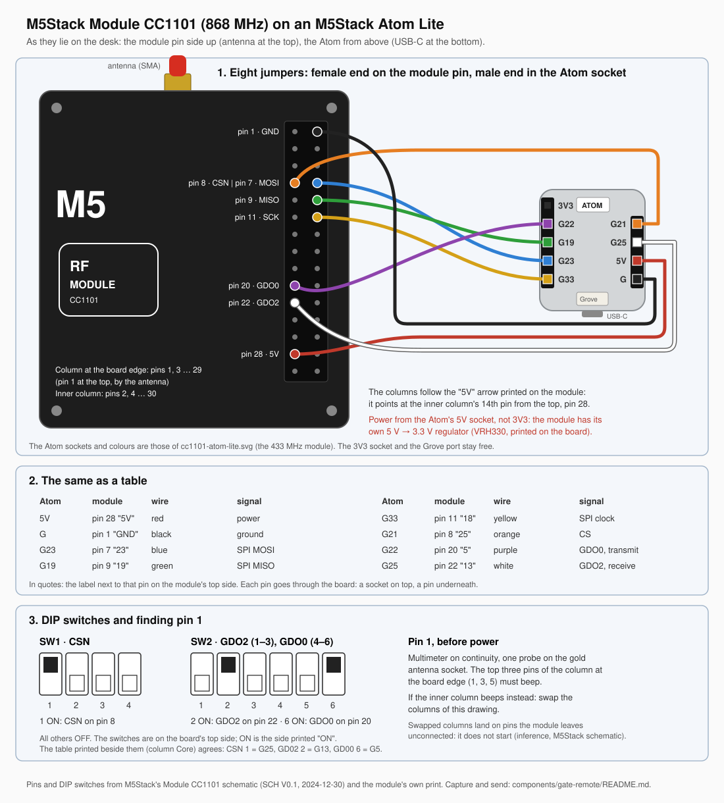
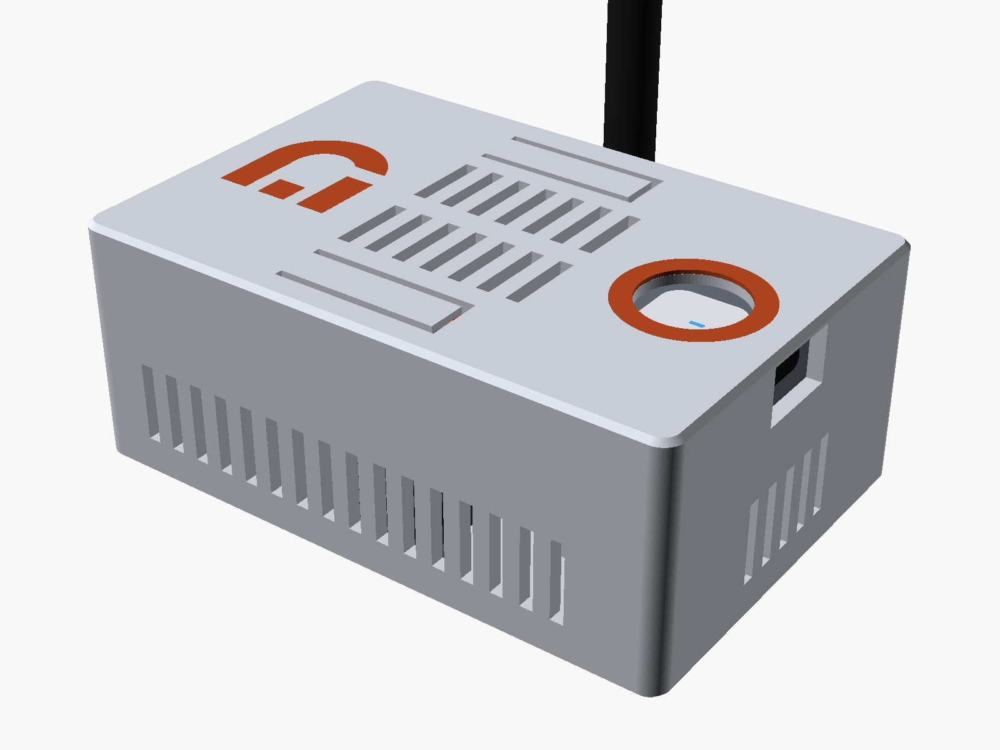

# M5Stack Module CC1101 (868 MHz): wiring and setup

M5Stack's Module CC1101 (SKU M146): an Ebyte **E07-900M10S** (CC1101, 855 to 925 MHz) on an M-Bus
module with an SMA antenna socket, wired to an M5Stack Atom Lite with eight Dupont jumpers. The
`gate-remote` component's node, which captures and sends a gate handset's code at 868 MHz.
Device file: [m5stack-module-cc1101.yaml](m5stack-module-cc1101.yaml). For 433 MHz the other module,
[cc1101.md](cc1101.md), has the same signals on the same Atom sockets.

## Wiring

| Atom Lite socket | module M-Bus pin | label on the module's top side | signal | wire |
|---|---|---|---|---|
| G | 1 | GND | ground | black |
| 5V | 28 | 5V | power | red |
| G23 | 7 | 23 | SPI MOSI | blue |
| G19 | 9 | 19 | SPI MISO | green |
| G33 | 11 | 18 | SPI clock | yellow |
| G21 | 8 | 25 | CSN | orange |
| G22 | 20 | 5 | GDO0, transmit data | purple |
| G25 | 22 | 13 | GDO2, receive data | white |

- **Power from 5V, never 3V3.** The module has its own regulator (VRH3301, 5 V → 3.3 V, M5Stack
  schematic SCH V0.1 2024-12-30); its M-Bus 3.3 V pin is not connected to anything.
- **The labels on the top side** are the GPIOs of M5Stack's Core controllers, not the Atom's: use
  them only to find a pin. Each pin goes through the board: a female socket on top, a short male pin
  underneath.
- **Pin columns on the pin side:** the column at the board edge holds the odd pins 1 to 29, pin 1 at
  the antenna end; the inner column the even pins 2 to 30. The module's printed "5V" arrow points at
  the inner column's 14th pin, which is pin 28. Before power, a continuity test from the antenna
  socket's shell must beep on the edge column's top three pins (1, 3, 5: ground).
- **Short pins.** Dupont sockets seat only part-way on the module's pins and can work loose. The node
  works that way (tested), but something that holds the eight housings is wise: the
  [enclosure](#enclosure) below, or a strip of tape.

## DIP switches

On the top side, next to a printed table. ON is the side printed "ON".

| switch | ON routes | set |
|---|---|---|
| SW1 1 | CSN to pin 8 | **ON** |
| SW1 2, 3, 4 | CSN to pins 23, 21, 24 | off |
| SW2 1, 2, 3 | GDO2 to pins 2, 22, 20 | **2 ON**, 1 and 3 off |
| SW2 4, 5, 6 | GDO0 to pins 2, 22, 20 | **6 ON**, 4 and 5 off |

GDO0 and GDO2 share the same three pins, so they must not be switched onto the same one.

## First start

Capture firmware and the steps: [components/gate-remote/README.md](../components/gate-remote/README.md).
At boot the log shows `CC1101 found! Chip ID: 0x0014`; `Failed to verify CC1101.` means one of the SPI
wires or CSN does not seat. Tested with the SPI bus at 1 MHz over Dupont jumpers.

## Enclosure

A printable three-part box for the module, the Atom and the eight jumpers: a clamp held down by two
spring flaps in the lid keeps the female housings on the module's short pins. No supports, no
screws; the lid snaps on. The Atom's button sits at the bottom of a finger well, and the antenna
stands upright out of the back wall.

- [How to print and assemble it](enclosures/m5stack-cc1101-atom-lite/README.md): print settings,
  hardware, wiring, assembly, the parameters and what a first print has to confirm.
- Bambu Studio projects (P2S, settings applied): [base](enclosures/m5stack-cc1101-atom-lite/3mf/base.3mf),
  [base with wall ears](enclosures/m5stack-cc1101-atom-lite/3mf/base_wall.3mf),
  [lid](enclosures/m5stack-cc1101-atom-lite/3mf/lid.3mf),
  [clamp](enclosures/m5stack-cc1101-atom-lite/3mf/clamp.3mf).
- STL for other slicers: [base](enclosures/m5stack-cc1101-atom-lite/stl/base.stl),
  [base with wall ears](enclosures/m5stack-cc1101-atom-lite/stl/base_wall.stl),
  [lid](enclosures/m5stack-cc1101-atom-lite/stl/lid.stl),
  [clamp](enclosures/m5stack-cc1101-atom-lite/stl/clamp.stl),
  [ring and logo inlay](enclosures/m5stack-cc1101-atom-lite/stl/lid_inlay_parts.stl) (optional,
  second filament).
- [Parametric source](enclosures/m5stack-cc1101-atom-lite/enclosure.scad) (OpenSCAD).

Nothing has been printed yet: the dimensions come from M5Stack's drawings, and the model checks its
own fits and strains.

## The antenna

Screw an 868 MHz antenna onto the SMA socket before the node transmits (the module ships with a
2.5 dBi rubber antenna). A CC1101 sending into an open socket can damage its output stage (general
radio practice, not seen here).
