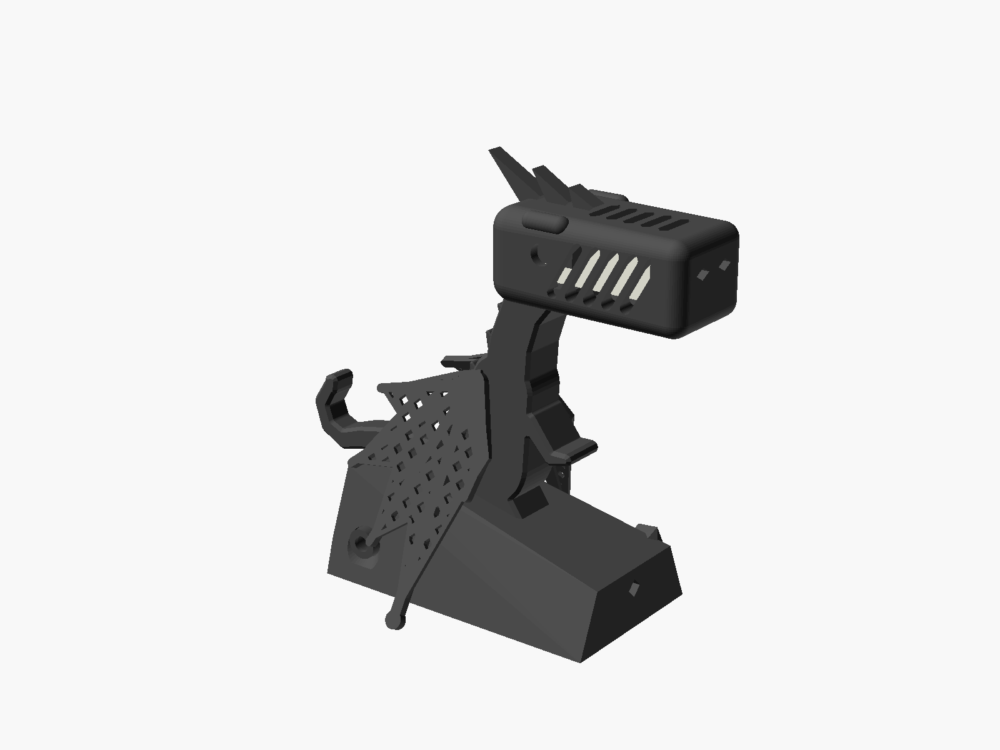

# M5Stack Unit CO2L: wiring, firmware and enclosure

M5Stack's Unit CO2L (SKU U104) is a Sensirion **SCD41** photoacoustic CO₂ sensor that also reads
temperature and humidity. It comes with a 20 cm Grove cable and hangs from an M5Stack Atom Lite, which
reports it to Home Assistant over ESPHome. One unit gives one room a CO₂ reading, and the Ramka shows
that room on its Air page (SPEC-042). Device file: [m5stack-unit-co2l.yaml](m5stack-unit-co2l.yaml).

## Wiring

Plug the unit's Grove cable into the Atom Lite's Grove port. It needs no other wiring.

| Atom Lite Grove pin | signal | ESPHome |
|---|---|---|
| 5V | power (the unit regulates to 3.3 V) | |
| G | ground | |
| G26 | I²C SDA | `sda: GPIO26` |
| G32 | I²C SCL | `scl: GPIO32` |

Keep the unit at the end of its cable, away from the Atom. The Atom's warmth raises the unit's own
temperature reading.

## Firmware

The catalog has no package for the unit yet. Add this to the Atom's ESPHome device file, next to
whatever the node already runs (a `bermuda-presence` proxy, for example):

```yaml
substitutions:
  altitude: 300m   # the room's height above sea level, for the pressure compensation

i2c:
  id: grove_i2c
  sda: GPIO26
  scl: GPIO32

sensor:
  - platform: scd4x
    id: co2_unit
    i2c_id: grove_i2c
    altitude_compensation: ${altitude}
    automatic_self_calibration: true
    update_interval: 60s
    co2:
      name: CO2
    temperature:
      name: CO2 unit temperature
      disabled_by_default: true   # the unit's own air, warmed by the Atom
    humidity:
      name: CO2 unit humidity
      disabled_by_default: true

api:
  actions:
    - action: calibrate_co2
      variables:
        co2_ppm: int
      then:
        - scd4x.perform_forced_calibration:
            value: !lambda 'return co2_ppm;'
            id: co2_unit
```

Name the CO₂ entity in the Ramka's `air` input as one room, for example
`{label: Bedroom, room: bedroom, co2: sensor.<node>_co2}`. With climate-air 0.3.1 or later, the
room's `air: {co2: sensor.<node>_co2}` in the home inputs adds the CO₂ limits (fair and poor),
which the Ramka settings dashboard changes.

## After the first start

- **Accuracy (Sensirion datasheet):** ±(50 ppm + 2.5 %) up to 1000 ppm and ±(50 ppm + 3 %) up to
  2000 ppm; specified to 5000 ppm.
- **Self-calibration:** it assumes the room reaches outdoor air, about 425 ppm, once a week. Treat the
  first week's readings as provisional.
- **A room that is never aired:** set `automatic_self_calibration: false` and calibrate by hand a few
  times a year. Run the unit for 3 minutes at a wide-open window, then call the node's
  `calibrate_co2` action with `co2_ppm: 425`.

## Enclosure



A printable bedside figure for the unit and the Atom: a dragon on a rock, joined by printed dowels and
dovetail keys without screws. The unit lies in the dragon's openwork head. The Atom sits in a cave in
the rock, where a hollow plunger presses its button and lets its LED glow through. The Grove ribbon
runs up a hollow core through the body and neck, and the USB-C cable through a tunnel in the rock.
The cave can be on the dragon's left or right.


- [How to print and assemble it](enclosures/m5stack-co2l-atom-lite/README.md): the test cuts and
  fit coupon to print first, the parts, print settings, assembly, measurements and what a print has
  not confirmed yet.
- Bambu Studio projects (P2S, settings applied). Halves with the cave on the dragon's left:
  [cave half](enclosures/m5stack-co2l-atom-lite/light_left/dragon_stand-half_r.3mf), [other half](enclosures/m5stack-co2l-atom-lite/light_left/dragon_stand-half_l.3mf);
  with the cave on its right: [cave half](enclosures/m5stack-co2l-atom-lite/light_right/dragon_stand-half_l.3mf),
  [other half](enclosures/m5stack-co2l-atom-lite/light_right/dragon_stand-half_r.3mf). Shared parts:
  [right wing](enclosures/m5stack-co2l-atom-lite/3mf/dragon_stand-wing_r.3mf), [left wing](enclosures/m5stack-co2l-atom-lite/3mf/dragon_stand-wing_l.3mf),
  [plunger](enclosures/m5stack-co2l-atom-lite/3mf/dragon_stand-plunger.3mf), [dowels](enclosures/m5stack-co2l-atom-lite/3mf/dragon_stand-plate_dowels_petg.3mf),
  [bottom key](enclosures/m5stack-co2l-atom-lite/3mf/dragon_stand-key_bottom.3mf) (print two), [back key](enclosures/m5stack-co2l-atom-lite/3mf/dragon_stand-key_rear.3mf).
- STL for other slicers: the same parts in the folder's `light_left/`, `light_right/` and `stl/`.
- [Parametric source](enclosures/m5stack-co2l-atom-lite/enclosure.scad) (OpenSCAD) and
  [build script](enclosures/m5stack-co2l-atom-lite/build.py).

The first build printed the halves, the wings and the keys. Its dowels came off the bed: they now lie
on a wider flat with a brim. Its wings were loose in 4 mm sockets: the pegs now go 8 mm deep. Neither
fix has been printed yet.
