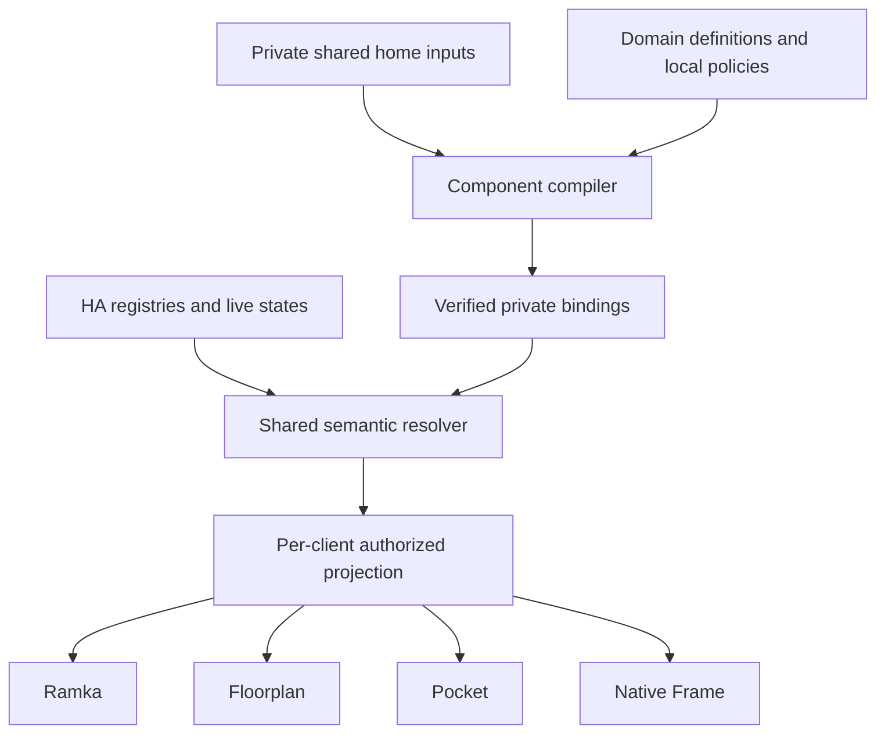

# Shared home data and component metadata

Design consolidation and rollout proposal, 2026-11-05.

This document connects the existing shared home inputs work with component assistant
contracts and the experimental Frame v2 client. It records the target architecture and
remaining decisions. It does not declare the experimental routes ready for release.
The implementation handoff is [the rollout checklist](../../handoffs/2026-11-05-shared-home-metadata.md).

## Intended result

A home defines its rooms, shared source bindings and local choices once. Ramka,
Floorplan, Pocket and the native Frame assistant can consume those definitions
independently. Adding Pocket or asking an assistant question must not require installing
Ramka to obtain room or sensor configuration. Removing a display must preserve the
home's data and other consumers.

A component defines the meaning of its data, supported questions and interpretation.
The home binds those definitions to actual HA entities. Compatible clients can use a
new subject or capability made from supported primitives after a metadata update.
New primitive types and new actuator operations require compatible implementation.

The initial catalog baseline has 14 components and 38 declared read/explanation
capabilities. Pocket is an additional component on `feature/pocket` and belongs in the
integration acceptance matrix when that branch is adopted. Future components use the
same conformance rules.

## Existing work to reuse

| Work | Inspected baseline | Consequence |
|---|---|---|
| Framework main | `013af945fad43217272aa6d2b3e52af82ef1322b` | Contains assistant definitions, private v1 bindings, source parity and light/awning action metadata |
| Shared home inputs | `feature/pocket` at `60a36a20da393b523bc0eb3bb476f3caee583e0a` | Has `home_inputs`, `uses_home`, a schema, loader, renderer integration and tests |
| Home inputs first implementation | `1e8f53fb7fc863743fd7b92a7fdd8c2ddbfd8687` | Preserve the reusable loader and standalone renderer behavior |
| Bridge main | `f6659cda094f0cbcec67c06f35f86ec11f35595e` | Existing component reads and explicit source selection |
| Bridge v1 increment | `c4d668904c07f9430d3a347f6fc9fdb32220174d`, PR #4 | Timers, shared sources and negotiated controls remain a pending integration dependency |
| Android main | `51540f0d36530531b1ebcc645444950a67a236ac` | Existing v1 voice/display/control lifecycle |
| Framework v2 experiment | `codex/frame-metadata-v2` at `e67f0c0` | Private metadata compiler and archived read-routing experiments |
| Bridge v2 experiment | `codex/frame-metadata-v2-bridge` at `bed8a1b` | Generic measurement reads and projection of authorized v1 evaluators |
| Android v2 experiment | `codex/frame-metadata-v2-android` at `20f082e` | Generic catalog session, matching and presentation, with experimental routing disabled |

These are inspection baselines, not a compatible release bill of materials. Resolve
full commit hashes and compare trees when beginning implementation. Branch tips can
advance. Preserve the reviewed v1 increments while reconciling the experimental code.

Read the metadata-client specification by its full path and revision. The historical
`.ai/specs/SPEC-034-2026-11-04-metadata-driven-frame-client.md` is available at `2b989bd`.
An unrelated gate component also uses SPEC-034 on another branch. Allocate a unique
number for this consolidation before submitting a new numbered specification, and
refer to existing documents by full path plus revision until that collision is resolved.

## Approaches and chosen direction

Keeping separate room/sensor configurations in each display preserves today's local
interfaces but makes changes drift. Making Ramka the central data provider couples
every consumer to one display component. A shared home input layer with component-owned
semantics removes that coupling while retaining HA's identities and permissions.

The third direction is the design choice here, consistent with the existing
`feature/pocket` implementation. Reuse that input format and extend its integration.
Do not introduce a competing home database or rename existing configuration keys as
part of the migration. These are proposed integration decisions for review.

## Ownership

| Layer | Authoritative content | Consumer responsibility |
|---|---|---|
| HA registries | Entity/device identities, HA area IDs and current membership | Validate referenced identities and handle removal or reassignment |
| Catalog categories, kinds and devices | Hardware classification and possible uses | Suggest mappings without granting access or inventing measurement semantics |
| Private `home.inputs.yaml` | Stable home room keys, explicit HA area references, shared source bindings and localized labels | Resolve a shared room/source without depending on a display |
| Domain component | Fact roles, units, freshness, assessment policy and supported capabilities | Compile the same semantics for every consumer |
| Private component inputs | Domain-specific subjects and local policy settings | Preserve local choices through upgrades |
| Client configuration | Layout, geometry, navigation, rotation, display order and visibility | Select a presentation and permitted subset of shared data |
| HA integration and runtime | Validate provenance, resolve data, enforce permissions and evaluate evidence | Return the current authorized projection |
| Native Frame | ASR, bounded intent matching, clarification, rendering, TTS and lifecycle | Interpret supported wire primitives and current descriptors |

The historical integration name `domosenso_frame` can remain during compatibility
migration. Shared domain resolution must not require a Ramka endpoint or its YAML.
Factor reusable resolution and policy code behind client adapters inside the free HA
integration first. Creating a second HA integration is unnecessary for this milestone.

## Shared inputs and runtime data

Use the existing `domosenso.yaml` key `home_inputs` to name the private file. The file
already supports `rooms`, `outside` and `weather`. Room fields include `id`, `name`,
`area`, `lights`, `scenes`, `climate`, `air` and `media`. Components declare `uses_home`
and templates receive `home` and `room_name`. The current loader validates file shape.

Shared inputs are installation configuration. HA supplies live state, device and area
membership. A compiled binding is a reference to that state and includes provenance.
Clients must not interpret a saved input file or a restored HA value as a current reading.

The schema's single room temperature or light reference is an explicit selected
source/default, not the room's complete device inventory. Keep additional sources as
distinct domain subjects or registry devices. A default room reading must not silently
replace another device's reading, merge subjects, or imply permission to read every
device in the area. Extend cardinality through a reviewed additive schema change if
a consumer needs multiple selected sources for one room role.

Keep plant definitions in plants, calendar selections in calendar, and threshold
policies in the owning domain component. Shared inputs can refer to their stable
subjects when consumers need them. Do not duplicate every domain's complete inputs in
the shared file. Credentials, device addresses and secrets stay in their existing
private configuration and are excluded from client discovery.

Retain the distinction between a home room key, an HA area ID and a floorplan polygon.
The home input loader currently permits an area default derived from the room key.
At runtime, verify that the resulting ID exists. A missing or ambiguous association
must be visible as an unresolved binding. Room-name resemblance and polygon overlap
do not establish membership. Floorplan geometry and manual visual placement remain
presentation data.

An example private shape using fictional entities follows the existing input schema.

```yaml
rooms:
  - id: living_room
    name: {en: Living room, de: Wohnzimmer, pl: Pokój dzienny}
    area: living_room
    climate:
      temperature: sensor.living_room_temperature
      humidity: sensor.living_room_humidity
    lights: light.living_room
outside:
  temperature: sensor.outside_temperature
weather: weather.forecast_home
```

This file does not assign an assessment threshold or authorize a light action.

## Meanings of role

Keep four separate concepts in the contract.

1. A hardware/category role describes a possible use, such as climate sensing.
2. A fact role identifies an exact semantic input, such as indoor temperature,
   moisture, reported position or last observed timestamp.
3. A capability describes a supported question or operation and its required facts.
4. A grant determines which user/device/endpoint may read or act on the resolved subjects.

Fact roles carry accepted units, source relation, cardinality, scope and freshness
requirements. Cross-component sources must follow declared `provides`, `consumes` and
`upstream` relationships. Binding an entity to `temperature` does not supply indoor
scope, an observation timestamp, or an evaluation policy by implication.

Use stable namespaced capability IDs and stable subject/area keys. Localized labels
and aliases help a person choose the key. Counts deduplicate subject keys, so a plant
with several metrics is counted once. Sensitive presence and calendar facts require
explicit exposure.

## One semantic source with several projections

The current `assistant.yaml` and component binding templates already own capabilities,
required/optional fact roles, evaluators, translations and freshness. Retain that
ownership. Add bounded matching and presentation metadata through a reviewed additive
contract change where the existing fields are insufficient.

The v2 experiment has a separate `assistant_metadata` declaration and a measurement
schema. Adopt its compiler/runtime work, but reconcile references to existing semantic
definitions. Do not maintain independent copies of thresholds, entities or role
meaning in v1 definitions, a v2 file, Bridge matching tables and Android. A separate
v2 artifact can contain compiled data from the same component revision.

The compiler emits private managed artifacts for supported protocol versions. Domain
evaluators can remain typed Bridge code. Existing specialized v1 evaluators for plant
estimates, weather, calendar and timers can provide v2 answers through adapters.
Metadata defines new capabilities composed from implemented primitives. A new evaluator
or unsupported fact type requires implementation and negotiation.

The inspected v2 Bridge still contains per-capability `ANCHORS`, selector families and
localized wording in `assistant_metadata_legacy.py`. These are migration adapters.
Move component-owned matching words and presentation labels into validated component
metadata as families migrate. Generic language grammar, type formatters and reviewed
write grammar remain implementation code.

## Runtime flow and authorization



Browser cards retain normal HA authentication and supported direct HA state access.
Native Frame retains its paired device and endpoint grants. Shared inputs do not create
a grant or require browser cards to impersonate a paired native device. The shared
resolver supplies consistent subject identity, policy and evidence through the
appropriate adapter. New public APIs require their own reviewed compatibility surface.

V2 discovery uses the already prototyped `assistant_metadata` and
`assistant_metadata_query` commands with explicit client primitive support. Revisions
must change on binding, permission, label, area or policy changes, while live numeric
updates retain their own timestamps. Validate the same authorization and identity
again before returning an asynchronous answer. Revocation cancels cached results.

Preserve v1 during rollout. A denied or malformed v2 request must not be retried using
a broader legacy scope. Reads, controls and timer mutations retain their distinct
grants and execution contracts. Models can rank bounded read candidates only after
scope validation. They cannot select writes or generate entity IDs or facts.

## Policy and presentation parity

Temperature/humidity and air assessment belong to their domain policies. Preserve
current effective values while migrating any legacy Ramka-owned configuration.
Display-specific colors and row heights stay client choices. The definition of
good/raised/high, effective thresholds, unit handling, missing evidence and freshness
must agree across Pocket, Floorplan, Ramka and Frame speech.

For example, one authorized CO2 source can appear as a Floorplan marker, Pocket tile,
Ramka card and spoken answer. All four must refer to the same source and policy
revision. Missing or stale readings produce qualified unavailable/partial evidence.
The numeric reading remains available when assessment policy is missing. Weather
and calendar must distinguish query time from provider synchronization time.

This requires client runtime work as well as shared input rendering. Pocket currently
refers to climate-air helper IDs while Ramka has its own air-policy template and helper
names. Resolve the effective domain policy in the migration, then update each card's
adapter and its missing/stale/assessment handling. Preserve visual-only choices.
Conformance fixtures must compare the cards' results with Bridge evidence.

Help lists the current supported and authorized capabilities, with localized examples.
Speech gives at most three short qualified clauses. Detailed views show scope,
source availability and the evidence behind the assessment. Both consume one typed
answer. PL/EN matching and speech are release requirements. Component metadata retains
en/de/pl translation coverage.

## Migration decisions

1. Reconcile `feature/pocket` shared inputs with current main before creating another
   input schema. Keep existing component-only homes renderable.
2. Provide a dry-run migration report for duplicated room/source/policy settings.
   Equal bindings can become shared references. Conflicts require an explicit choice.
   Never choose a threshold or entity silently by precedence across displays.
3. Preserve local overrides, managed-file ownership, deploy hashes and rollback.
   One shared edit must invalidate every affected dependent render. Removing one
   client must not remove shared inputs or another component's bindings.
4. Keep HA registries and per-client grants authoritative. Reconcile renamed, deleted
   and reassigned entities without broadening scopes.
5. Complete all 14 baseline component read/explanation families through the existing
   projection path, then onboard Pocket and future components using the same checks.
6. Activate v2 after the held-out routing and compatibility gates pass. Preserve v1
   execution routes for existing approved controls and timers during this milestone.

## Completion evidence

Use two independent fictional homes. One installs Pocket/Floorplan/assistant data
without Ramka. The other starts from legacy duplicated inputs. Add, rename, replace
and remove a source and change one domain policy. Verify consistent identity and
assessment in every consumer while retaining independent layout and grant choices.
Include two distinct temperature subjects in one room with an explicitly selected
default, and verify that the other subject remains independently addressable.

Expose a fictional `workbench.station_temperature` using supported primitives and
fictional bindings on an unchanged Bridge build and APK. Then expose a second
capability with a different ID, such as `workbench.station_humidity`, using supported
primitives on those same binaries. Repeat with a new subject and alias. Help,
selection, typed facts, screen and speech must update. An unsupported primitive must
remain unavailable and explain the compatibility limit.

Record coverage by component and capability, old/new Bridge and APK combinations,
missing/stale/partial/denied cases, permission revocation during an answer and physical
display/voice evidence separately. The next implementer must not infer catalog-wide
acceptance from one working temperature example.

## Pinned source references

- [Shared input schema and implementation baseline](https://github.com/zerostorypoints/domosenso/blob/60a36a20da393b523bc0eb3bb476f3caee583e0a/schemas/home-inputs.schema.json)
- [Existing assistant ownership and domain contract](https://github.com/zerostorypoints/domosenso/blob/013af945fad43217272aa6d2b3e52af82ef1322b/docs/ASSISTANT.md)
- [Approved metadata-client design at its historical path](https://github.com/zerostorypoints/domosenso/blob/2b989bd/.ai/specs/SPEC-034-2026-11-04-metadata-driven-frame-client.md)
- [Archived routing evidence](https://github.com/zerostorypoints/domosenso/blob/e67f0c0ed4557e0bd45d569d7c3583f176149c20/docs/research/frame-read-routing/matcher/README.md)
- [Routing follow-up issue](https://github.com/zerostorypoints/domosenso/issues/203)
- [Pending Bridge v1 integration](https://github.com/zerostorypoints/domosenso-frame-ha/pull/4)
